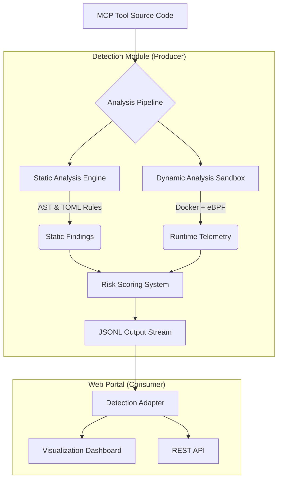

# MCP Security Tools Detection

**Advanced Security Analysis Framework for Model Context Protocol (MCP) Servers**

[](https://github.com/your-org/mcp-security)
[](LICENSE)
[](https://python.org)
[](https://docker.com)
[](detection/README.md)

## 📖 Abstract

This repository constitutes the research artifact for the study on **Security Risks in Model Context Protocol (MCP) Systems**. As Large Language Model (LLM) agents increasingly rely on MCP to interact with external tools and data, they inherit significant security vulnerabilities ranging from Remote Code Execution (RCE) to novel threats like Indirect Prompt Injection.

**MCP Tools Detection** provides a comprehensive, multi-layered defense mechanism combining static code analysis (AST-based) with dynamic runtime monitoring (eBPF-based) to identify malicious or vulnerable MCP servers before they can compromise an agentic workflow.

## 🏗 System Architecture

The system operates on a "Producer-Consumer" architecture designed for scalability and depth of analysis.



### 1. Detection Engine (`detection/`)
The core analysis framework implementing a hybrid detection approach:
-   **Static Analysis**: Parses Python Abstract Syntax Trees (AST) to detect dangerous function calls, variable tainting, and known malicious patterns defined in `keywords.toml`.
-   **Dynamic Analysis**: Orchestrates Docker containers instrumented with eBPF (Extended Berkeley Packet Filter) to capture kernel-level system calls (`sys_execve`, `sys_open`, `sys_connect`). This allows detection of obfuscated malicious behavior that evades static analysis.
-   **Policy Engine**: Evaluates findings against configurable risk thresholds to assign `CRITICAL`, `HIGH`, `MEDIUM`, or `LOW` severity scores.

### 2. Web Detection Portal (`web-detection-portal/`)
A visualization and management interface that consumes the structured output from the detection engine:
-   **Automated Ingestion**: Real-time monitoring of detection results.
-   **Interactive Dashboard**: Filterable views of security findings.
-   **API Integration**: REST endpoints for integrating scanning into CI/CD pipelines.

### 3. Vulnerable Lab (`detection/examples/vulnerable-mcp-servers-lab`)
A ground-truth dataset of intentionally vulnerable MCP servers covering:
-   **Remote Code Execution (RCE)**: Unsafe `eval()`, `subprocess`.
-   **Prompt Injection**: Data exfiltration via hidden instructions.
-   **Path Traversal**: Arbitrary file read/write.
-   **Typosquatting**: Supply chain attack simulation.

---

## 🚀 Quick Start

### Prerequisites

-   **Python 3.9+** (Managed via `uv`)
-   **Docker** & **Docker Compose** (Required for Dynamic Analysis)
-   **Linux Kernel >= 4.4** (or Docker Desktop with Linux VM) for eBPF support.
-   **[uv](https://github.com/astral-sh/uv)**: High-performance Python package manager.

```bash
# Install uv
curl -LsSf https://astral.sh/uv/install.sh | sh
```

### Phase 1: Run the Detection Benchmark

This step executes the analysis pipeline against the MCPTox benchmark (491 samples).

```bash
cd detection

# 1. Initialize environment
uv sync

# 2. Build the Dynamic Sandbox (Critical for runtime monitoring)
cd sandbox
docker-compose build
cd ..

# 3. Run the Benchmark
# This downloads samples, runs static analysis, and generates the report.
uv run mcptox-benchmark
```

*Output Location:* `detection/examples/benchmarks/mcptox/output/per_file_detection.jsonl`

### Phase 2: Launch the Visualization Portal

Start the web interface to explore the results generated in Phase 1.

```bash
cd ../web-detection-portal

# 1. Initialize environment
uv sync

# 2. Start the Server
uv run python app.py
```

*Access:* **http://localhost:3003**

---

## 🧪 Advanced Usage

### Running Dynamic Analysis on a Custom Target

To analyze a specific MCP server using the full capabilities of the dynamic sandbox:

```bash
cd detection
uv run examples/dynamic_analysis_demo.py
```
This script demonstrates the complete lifecycle:
1.  Synthesizes a malicious MCP tool (obfuscated RCE).
2.  Runs **Static Analysis** (AST parsing).
3.  Spins up the **Docker Sandbox**.
4.  Attaches **eBPF Probes**.
5.  Executes the malware and captures `execve` syscalls.
6.  Outputs a comparative risk report.

### 🔬 Lab Case Study: Vulnerable Filesystem Server

Let's walk through a concrete example using the **Filesystem Workspace Actions** server (`detection/examples/vulnerable-mcp-servers-lab/vulnerable-mcp-server-filesystem-workspace-actions`), which contains a Path Traversal vulnerability.

#### Scan for Vulnerabilities (Static Analysis)

Use the detection engine CLI to identify security flaws in the target repository.

> **Note**: Static analysis (default) is optimized for Python targets. For Node.js/Polyglot targets, use `--pipeline dynamic`.

```bash
cd detection

# Run the CLI scanner against the vulnerable server path
uv run python -m detection.cli examples/vulnerable-mcp-servers-lab/vulnerable-mcp-server-filesystem-workspace-actions
```

**Expected Output:**
The tool will analyze the AST and identify dangerous capabilities:
```text
REPORT:
Target: .../vulnerable-mcp-server-filesystem-workspace-actions
Risk Level: HIGH

Findings:
[CRITICAL] Command Execution
  - Evidence: subprocess.Popen(...)
  - Confidence: 0.95

[HIGH] Arbitrary File Write
  - Evidence: open(path, 'w')
  - Confidence: 0.88
```

---

## 📂 Project Structure

```text
mcp-tools-detection/
├── detection/                            # [Artifact] Core Analysis Engine
│   ├── detection/
│   │   ├── core/                         # Analysis logic (AST, Graph)
│   │   ├── rules/                        # TOML Detection Rules
│   │   ├── sandbox/                      # Docker + eBPF Infrastructure
│   │   │   ├── Dockerfile                # Sandbox Environment
│   │   │   └── monitors/                 # BCC/eBPF Python Scripts
│   │   └── plugins/                      # Static/Dynamic Plugin System
│   ├── examples/
│   │   ├── benchmarks/mcptox/            # [Data] 491 Benchmark Samples
│   │   │   └── run_mcptox_benchmark.py   # Benchmark Entry Point
│   │   └── vulnerable-mcp-servers-lab/   # [Data] Vulnerability Ground Truth
│   └── pyproject.toml                    # Dependency Definitions
│
├── web-detection-portal/                 # [Tool] Visualization Interface
│   ├── app.py                            # Flask Application
│   ├── detection_adapter.py              # Data Bridge (JSONL Parser)
│   └── templates/                        # Dashboard UI
│
└── docker-compose.yml                    # Deployment Configuration
```

## 📊 Technical Capabilities

| Category | Capability | Technology |
| :--- | :--- | :--- |
| **Static Code Analysis** | Syntax Tree Traversal, Taint Analysis | Python `ast`, Custom Visitors |
| **Runtime Monitoring** | Syscall Interception (`exec`, `open`, `net`) | Linux eBPF, BCC |
| **Isolation** | Containerization, Network Namespace | Docker |
| **Risk Scoring** | Weighted Heuristics | Custom Policy Engine |
| **Vulnerability Types** | RCE, File Access, Network C2, Prompt Injection | Hybrid Detection Rules |

## 🔗 Documentation

*   **[Detection Engine Documentation](detection/README.md)**: Deep dive into the analysis algorithms and rule definitions.
*   **[Dynamic Sandbox Guide](detection/sandbox/README.md)**: Implementation details of the eBPF monitoring system.
*   **[Vulnerable Lab Index](detection/examples/vulnerable-mcp-servers-lab/README.md)**: Catalog of implemented vulnerabilities.
*   **[Web Portal Guide](web-detection-portal/README.md)**: API usage and dashboard configuration.

## ⚖️ License

This project is licensed under the MIT License - see the [LICENSE](LICENSE) file for details.

This artifact is provided for **research and defensive purposes only**.