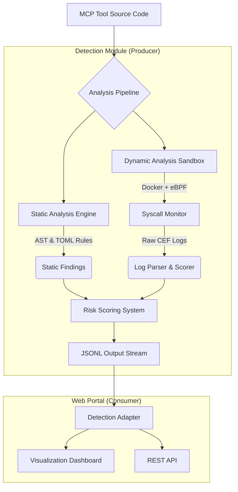

# MCP Security Auditor

**Advanced Security Analysis Framework for Model Context Protocol (MCP) Servers**

[](https://github.com/your-org/mcp-security)
[](LICENSE)
[](https://python.org)
[](https://docker.com)
[](detection/README.md)

## 📖 Abstract

This repository constitutes the research artifact for the study on **Security Risks in Model Context Protocol (MCP) Systems**. As Large Language Model (LLM) agents increasingly rely on MCP to interact with external tools and data, they inherit significant security vulnerabilities ranging from Remote Code Execution (RCE) to novel threats like Indirect Prompt Injection.

**MCP Tools Detection** provides a comprehensive, multi-layered defense mechanism combining static code analysis (AST-based) with dynamic runtime monitoring (eBPF-based) to identify malicious or vulnerable MCP servers before they can compromise an agentic workflow.

## 🏗 System Architecture

The system operates on a "Producer-Consumer" architecture designed for scalability and depth of analysis.



### 1. Detection Engine (`detection/`)
The core analysis framework implementing a hybrid detection approach:
-   **Static Analysis**: Parses Python Abstract Syntax Trees (AST) to detect dangerous function calls, variable tainting, and known malicious patterns defined in `keywords.toml`.
-   **Dynamic Analysis**: Orchestrates Docker containers instrumented with eBPF (Extended Berkeley Packet Filter) to capture kernel-level system calls (`sys_execve`, `sys_open`, `sys_connect`). This allows detection of obfuscated malicious behavior that evades static analysis.
-   **Policy Engine**: Evaluates findings against configurable risk thresholds to assign `CRITICAL`, `HIGH`, `MEDIUM`, or `LOW` severity scores.

### 2. Web Detection Portal (`web-detection-portal/`)
A visualization and management interface that consumes the structured output from the detection engine:
-   **Automated Ingestion**: Real-time monitoring of detection results.
-   **Interactive Dashboard**: Filterable views of security findings.
-   **API Integration**: REST endpoints for integrating scanning into CI/CD pipelines.

### 3. Vulnerable Lab (`detection/examples/vulnerable-mcp-servers-lab`)
A ground-truth dataset of intentionally vulnerable MCP servers covering:
-   **Remote Code Execution (RCE)**: Unsafe `eval()`, `subprocess`.
-   **Prompt Injection**: Data exfiltration via hidden instructions.
-   **Path Traversal**: Arbitrary file read/write.
-   **Typosquatting**: Supply chain attack simulation.

---

## 🚀 Quick Start

### Prerequisites

-   **Python 3.9+** (Managed via `uv`)
-   **Docker** & **Docker Compose** (Required for Dynamic Analysis)
-   **Linux Kernel >= 4.4** (or Docker Desktop with Linux VM) for eBPF support.
-   **[uv](https://github.com/astral-sh/uv)**: High-performance Python package manager.

```bash
# Install uv
curl -LsSf https://astral.sh/uv/install.sh | sh
```

### Installation & Verification

#### Step 1: Clone and Setup

```bash
# Clone the repository
git clone https://github.com/nyit-vancouver/mcp-sec-audit.git
cd mcp-sec-audit

# Initialize and update git submodules (required for vulnerable-mcp-servers-lab)
git submodule update --init --recursive

# Navigate to detection directory
cd detection

# Initialize Python environment
uv sync
```

#### Step 2: Verify Installation

Run the following commands to confirm successful installation:

**1. Check CLI Access**
```bash
# Display help menu
uv run python -m detection.cli --help
```

Expected output should show:
```
usage: cli.py [-h] [--pipeline {static,dynamic,rag}] [--format {markdown,json}]
              [--output OUTPUT] [--policy-dir POLICY_DIR] [--rules RULES]
              target
```

**2. Test Static Analysis**
```bash
# Run a quick scan on a sample vulnerable server
uv run python -m detection.cli \
    examples/vulnerable-mcp-servers-lab/vulnerable-mcp-server-filesystem-workspace-actions \
    --format markdown
```

Expected output includes:
- ✅ Detected capabilities (e.g., `file_read`, `file_write`, `command_exec`)
- ✅ Risk score and risk level (e.g., `HIGH`)
- ✅ Mitigation recommendations

**3. Verify Docker Setup (Optional - for Dynamic Analysis)**
```bash
cd sandbox
docker-compose build
docker-compose up -d
docker-compose down
```

If successful, you'll see:
```
✓ Building mcp-sandbox...
✓ Container mcp-sandbox started
```

#### Step 3: Quick Validation Test

Run this one-liner to verify end-to-end functionality:

```bash
cd detection
uv run python -m detection.cli examples/vulnerable-mcp-servers-lab/vulnerable-mcp-server-filesystem-workspace-actions --format json | grep -q "risk_level" && echo "✅ Installation verified successfully!" || echo "❌ Installation verification failed"
```

---

### Phase 1: Run the Detection Benchmark

This step executes the analysis pipeline against the MCPTox benchmark (491 samples).

```bash
cd detection

# 1. Initialize environment
uv sync

# 2. Build the Dynamic Sandbox (Critical for runtime monitoring)
cd sandbox
docker-compose build
cd ..

# 3. Run the Benchmark
# This downloads samples, runs static analysis, and generates the report.
uv run mcptox-benchmark
```

*Output Location:* `detection/examples/benchmarks/mcptox/output/per_file_detection.jsonl`

### Phase 2: Launch the Visualization Portal

Start the web interface to explore the results generated in Phase 1.

```bash
cd ../web-detection-portal

# 1. Initialize environment
uv sync

# 2. Start the Server
uv run python app.py
```

*Access:* **http://localhost:3003**

---

## 🧪 Advanced Usage

### Running Dynamic Analysis on a Custom Target

To analyze a specific MCP server using the full capabilities of the dynamic sandbox:

```bash
cd detection
uv run examples/dynamic_analysis_demo.py
```
This script demonstrates the complete lifecycle:
1.  Synthesizes a malicious MCP tool (obfuscated RCE).
2.  Runs **Static Analysis** (AST parsing).
3.  Spins up the **Docker Sandbox**.
4.  Attaches **eBPF Probes**.
5.  Executes the malware and captures `execve` syscalls.
6.  Outputs a comparative risk report.

### 🔬 Scanning Vulnerable Servers from the Lab

The `vulnerable-mcp-servers-lab` contains multiple intentionally vulnerable MCP servers for testing. Here's how to detect them:

#### Static Analysis (Python Targets)

```bash
cd detection

# Scan a Python-based vulnerable server
uv run python -m detection.cli \
    examples/vulnerable-mcp-servers-lab/vulnerable-mcp-server-filesystem-workspace-actions \
    --format json \
    --output output/result.jsonl
```

#### Dynamic Analysis (Node.js / Polyglot Targets)

```bash
cd detection

# Scan a Node.js server using Docker + eBPF sandbox
uv run python -m detection.cli \
    examples/vulnerable-mcp-servers-lab/vulnerable-mcp-server-malicious-code-exec \
    --pipeline dynamic \
    --output output/result.jsonl
```

### 🔗 CLI to Web Portal Integration

The system provides **real-time integration** between the CLI and Web Portal through a watched directory.

#### How It Works

```text
┌─────────────┐     ┌──────────────────┐     ┌─────────────────┐
│  CLI Scan   │ ──▶ │ detection/output │ ──▶ │   Web Portal    │
│  --output   │     │   (*.jsonl)      │     │  (auto-import)  │
└─────────────┘     └──────────────────┘     └─────────────────┘
                           │
                           ▼
                    Auto-delete after
                       import
```

#### Step-by-Step Workflow

**Terminal 1: Start the Web Portal**
```bash
cd web-detection-portal
uv sync
uv run python app.py

# Output:
# 👁  Watching directory: .../detection/output
#    Patterns: ['*.jsonl', '*.json']
#    Interval: 5s
#    Delete after import: True
# 🚀 Starting mcp-sec-audit server...
```

**Terminal 2: Run Detection and Output to Watched Directory**
```bash
cd detection

# Scan and output to the watched directory
uv run python -m detection.cli \
    examples/vulnerable-mcp-servers-lab/vulnerable-mcp-server-filesystem-workspace-actions \
    --format json \
    --output output/scan_result.jsonl
```

**What Happens Automatically:**
1. CLI writes `scan_result.jsonl` to `detection/output/`.
2. Web Portal detects the new file within 5 seconds.
3. Web Portal imports all results and displays them on the dashboard.
4. Web Portal deletes the file after successful import.

**Terminal 1 Output:**
```text
📥 Detected new file: scan_result.jsonl
   ✓ Imported 1 results
   ✓ Deleted scan_result.jsonl
```

#### Configuration Options

Edit `web-detection-portal/config.py` to customize behavior:

```python
# Enable/disable directory watching
WATCH_ENABLED = True

# Directory to watch (default: detection/output)
WATCH_DIRECTORY = Path("...") / "detection" / "output"

# Polling interval in seconds
WATCH_INTERVAL = 5

# Auto-delete files after import
DELETE_AFTER_IMPORT = True
```

---

## 📂 Project Structure

```text
mcp-sec-audit/
├── detection/                            # [Artifact] Core Analysis Engine
│   ├── detection/
│   │   ├── core/                         # Analysis logic (AST, Graph)
│   │   ├── rules/                        # TOML Detection Rules
│   │   ├── sandbox/                      # Docker + eBPF Infrastructure
│   │   │   ├── Dockerfile                # Sandbox Environment
│   │   │   └── monitors/                 # BCC/eBPF Python Scripts
│   │   └── plugins/                      # Static/Dynamic Plugin System
│   ├── examples/
│   │   ├── benchmarks/mcptox/            # [Data] 491 Benchmark Samples
│   │   │   └── run_mcptox_benchmark.py   # Benchmark Entry Point
│   │   └── vulnerable-mcp-servers-lab/   # [Data] Vulnerability Ground Truth
│   └── pyproject.toml                    # Dependency Definitions
│
├── web-detection-portal/                 # [Tool] Visualization Interface
│   ├── app.py                            # Flask Application
│   ├── detection_adapter.py              # Data Bridge (JSONL Parser)
│   └── templates/                        # Dashboard UI
│
└── docker-compose.yml                    # Deployment Configuration
```

## 📊 Technical Capabilities

| Category | Capability | Technology |
| :--- | :--- | :--- |
| **Static Code Analysis** | Syntax Tree Traversal, Taint Analysis | Python `ast`, Custom Visitors |
| **Runtime Monitoring** | Syscall Interception (`exec`, `open`, `net`) | Linux eBPF, BCC (Outputs CEF Logs) |
| **Isolation** | Containerization, Network Namespace | Docker |
| **Risk Scoring** | Weighted Heuristics (Aggregates CEF Events) | Custom Policy Engine |
| **Vulnerability Types** | RCE, File Access, Network C2, Prompt Injection | Hybrid Detection Rules |
| **CLI Integration** | File output with `--output`, JSONL format | Direct file write |
| **Web Integration** | Directory watching, auto-import, auto-delete | Background thread polling |

## 🛠 CLI Reference

```bash
uv run python -m detection.cli <target> [options]
```

| Option | Description | Default |
| :--- | :--- | :--- |
| `<target>` | Path to MCP server directory | (required) |
| `--pipeline` | Analysis mode: `static`, `dynamic`, `rag` | `static` |
| `--format` | Output format: `markdown`, `json` | `markdown` |
| `--output`, `-o` | Save to file (`.jsonl` for web compatibility) | stdout |
| `--policy-dir` | Mitigation policy templates directory | `detection/mitigation/policy_templates` |
| `--rules` | Detection rules file | `detection/rules/keywords.toml` |

**Examples:**
```bash
# Quick scan (output to terminal)
uv run python -m detection.cli path/to/server

# JSON output for programmatic use
uv run python -m detection.cli path/to/server --format json

# Dynamic analysis with file output
uv run python -m detection.cli path/to/server --pipeline dynamic -o output/result.jsonl

# Batch scan multiple servers
for server in examples/vulnerable-mcp-servers-lab/*/; do
    uv run python -m detection.cli "$server" --format json -o output/batch.jsonl
done
```

## 🔗 Documentation

*   **[Detection Engine Documentation](detection/README.md)**: Deep dive into the analysis algorithms and rule definitions.
*   **[Dynamic Sandbox Guide](detection/sandbox/README.md)**: Implementation details of the eBPF monitoring system.
*   **[Vulnerable Lab Index](detection/examples/vulnerable-mcp-servers-lab/README.md)**: Catalog of implemented vulnerabilities.
*   **[Web Portal Guide](web-detection-portal/README.md)**: API usage and dashboard configuration.

## ⚖️ License

This project is licensed under the MIT License - see the [LICENSE](LICENSE) file for details.

This artifact is provided for **research and defensive purposes only**.
