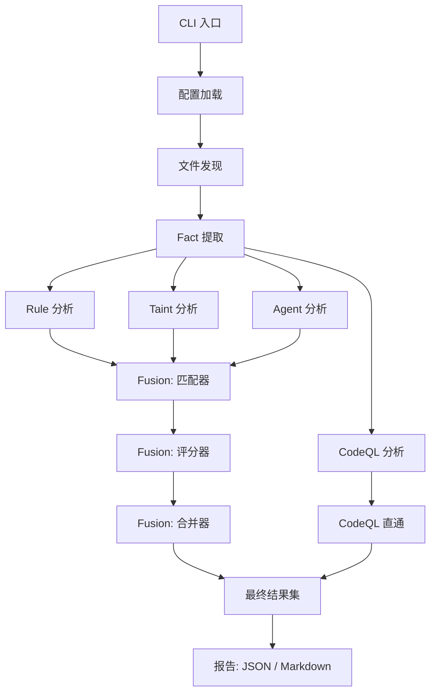

# MCP Security Auditor — 静态分析架构与技术原理

> **版本**：1.0.0  
> **Schema 版本**：1.0.0  
> **当前阶段**：phase9-rust-fact-extraction  
> **语言**：Rust（从 Python 原型 100% 重写）  
> **Crate 结构**：`mcp-sec-audit-core`（核心库） + `mcp-sec-audit-cli`（CLI 二进制）

---

## 目录

1. [系统概览](#1-系统概览)
2. [数据模型](#2-数据模型)
3. [配置系统](#3-配置系统)
4. [文件发现](#4-文件发现)
5. [Fact 提取](#5-fact-提取)
6. [Rule 分析线](#6-rule-分析线)
7. [Taint 分析线](#7-taint-分析线)
8. [Agent 分析线](#8-agent-分析线)
9. [CodeQL 分析线](#9-codeql-分析线)
10. [Fusion 融合系统](#10-fusion-融合系统)
11. [Pipeline 编排](#11-pipeline-编排)
12. [报告与输出](#12-报告与输出)

---

## 1. 系统概览

### 1.1 架构理念

MCP Security Auditor 是一个**多线静态分析系统**，专为审计 MCP（Model Context Protocol）服务端实现的安全漏洞而设计。系统采用四条独立分析线并行运行，最终通过置信度加权融合系统将结果合并为统一的发现集合。每条线覆盖漏洞检测的不同维度：

| 分析线 | 方法 | 优势 | 劣势 |
|---|---|---|---|
| **Rule** | 模式匹配（关键词 + 正则） | 快速、确定性、对已知模式低漏报 | 无法检测新模式、无数据流感知 |
| **Taint** | 统一程序图 + BFS 传播 | 跨函数追踪数据流、理解调用链 | 限于文件内分析、依赖 Fact 提取质量 |
| **Agent** | LLM 语义分析 | 理解上下文、检测新型漏洞模式 | 非确定性、较慢、受 LLM 限制 |
| **CodeQL** | 语义查询引擎（SARIF 输出） | 生产级、深度语义理解 | 仅支持 Python/JS/TS、需要 CodeQL CLI、最慢 |

这四条线通过 **Fusion** 子系统进行融合，执行两阶段贪心匹配、加权置信度评分、交叉验证加成和 LLM 独报上限，最终产出统一的发现结果。

### 1.2 高层数据流



### 1.3 Crate 架构

```
rust/
├── crates/
│   ├── mcp-sec-audit-core/       # 核心库 — 所有分析逻辑
│   │   └── src/
│   │       ├── lib.rs            # 重导出、常量
│   │       ├── config.rs         # RuntimeConfig 层级
│   │       ├── model/            # 数据模型: enums, facts, static_result
│   │       ├── rules.rs          # RuleBook TOML 解析
│   │       ├── reporting.rs      # JSON/Markdown 渲染器
│   │       ├── fixtures.rs       # 合成测试固件
│   │       └── static_analysis/  # 核心分析引擎
│   │           ├── mod.rs        # 模块声明
│   │           ├── pipeline.rs   # 编排器: run_static_scan()
│   │           ├── discovery.rs  # 文件系统发现
│   │           ├── facts/        # Fact 提取（Python/JS-TS/Rust）
│   │           ├── rule/         # Rule 分析线
│   │           ├── taint/        # Taint 分析线
│   │           ├── agent/        # Agent（LLM）分析线
│   │           ├── codeql/       # CodeQL 分析线
│   │           └── fusion/       # 融合系统（匹配/评分/合并/直通）
│   └── mcp-sec-audit-cli/        # CLI 二进制 — 薄封装
│       └── src/main.rs           # clap CLI，含 Status/Config/Rules/Report/Scan 命令
```

---

## 2. 数据模型

### 2.1 核心枚举（`model/enums.rs`）

系统定义了 8 种核心枚举类型，构成安全分析的词汇体系：

#### EvidenceSource（证据来源）
```rust
enum EvidenceSource { Static, Dynamic, Knowledge, Manual }
```
标记证据来源。静态分析产出 `Static` 证据；动态沙箱分析产出 `Dynamic`；规则库产出 `Knowledge`；人工输入产出 `Manual`。

#### Confidence（置信度）与 Severity（严重度）
```rust
enum Confidence { High, Medium, Low }
enum Severity { Critical, High, Medium, Low }
```
所有分析线和融合输出统一使用的三/四档等级。在融合评分器中，Confidence 映射为数值（0.8/0.6/0.4）。Severity 采用序数等级（Critical=4, High=3, Medium=2, Low=1）。

#### ImportKind（导入类型，13 种变体）
```rust
enum ImportKind {
    // Python: Import, ImportAs, FromImport, FromImportAs
    // JavaScript: Require, RequireDestructure, EsmImport, EsmImportAs, EsmNamedImport
    // Rust: Use, UseAs, UseGlob, UseGroup
}
```
涵盖三种语言族的所有导入/require/use 语法变体。

#### EntryPointKind（入口类型）
```rust
enum EntryPointKind { McpTool, McpResource, McpPrompt }
```
标识 MCP 协议入口点——面向用户的 API 面，是污点追踪的起点。

#### PathStepKind（路径步类型）
```rust
enum PathStepKind { Param, Assign, Return, CallArg, FieldAccess }
```
描述污点传播路径中的每一步：参数绑定（`Param`）、变量重赋值（`Assign`）、返回值捕获（`Return`）、参数传递（`CallArg`）、结构体字段访问（`FieldAccess`）。

### 2.2 Fact 系统（`model/facts.rs`）

Fact 是将提取与分析解耦的中间表示。所有 Fact 共享 `FactBase`：

```rust
struct FactBase {
    id: String,        // 全局唯一标识符
    file: String,      // 源文件路径
    line: u32,         // 1-based 行号
    extractor: String, // "python", "javascript", "typescript" 或 "rust"
}
```

`Fact` 是一个**标签枚举**，共 10 种变体：

| # | 变体 | 用途 | 关键字段 |
|---|---|---|---|
| 1 | `Function` | 函数定义 | `name`, `qualified_name`, `params`, `decorators`, `return_type`, `enclosing_class` |
| 2 | `Import` | 导入语句 | `module`, `imported_name`, `alias`, `kind`（ImportKind） |
| 3 | `Entrypoint` | MCP 工具/资源/提示 | `kind`（EntryPointKind）, `name`, `function_id`, `params` |
| 4 | `Call` | 函数调用点 | `caller`, `callee`, `normalized_callee`, `args`, `kwargs`, `resolution` |
| 5 | `Sink` | 危险函数分类 | `call_id`, `category`, `severity_base`, `reason`, `conditions` |
| 6 | `Source` | 用户可控数据来源 | `kind`, `function_id`, `name` |
| 7 | `Assign` | 变量赋值 | `function_id`, `target`, `value` |
| 8 | `Dataflow` | 从源到汇的污点路径 | `source_id`, `sink_id`, `path`（Vec\<PathStep\>）, `confidence` |
| 9 | `RuntimeEvent` | 动态沙箱观测 | `kind`, `syscall`, `command`, `pid`, `correlated_entrypoint` |
| 10 | `Finding` | 完整漏洞报告 | `title`, `category`, `severity`, `status`, `call_chain`, `recommendation` |

#### ID 命名规范

所有 Fact ID 遵循确定性的、以冒号分隔的格式：

| ID 类型 | 格式 | 示例 |
|---|---|---|
| Function | `{lang}:{file}:{name}` | `python:server.py:run_command` |
| Call | `call:{file}:{line}:{col}` | `call:server.py:8:4` |
| Sink | `sink:{category}:{file}:{line}` | `sink:command_exec:server.py:8` |
| Source | `source:{file}:{func}:{param}` | `source:server.py:handler:cmd` |
| Entrypoint | `entry:{file}:{name}` | `entry:server.py:run_command` |
| Import | `import:{file}:{line}` | `import:server.py:1` |
| Assign | `assign:{file}:{line}:{col}` | `assign:server.py:5:0` |

### 2.3 结果类型（`model/static_result.rs`）

每条分析线产生不同的结果类型，融合后产出最终的 `FusedFinding`：

```rust
struct RuleAnalysisResult {
    result_id: String, rule_id: String, category: String,
    file: String, line: u32, matched_text: Option<String>,
    evidence: Vec<String>, severity: Severity, confidence: Confidence, ...
}

struct TaintAnalysisResult {
    result_id: String, source_id: String, source_kind: String,
    sink_id: String, sink_kind: String, entrypoint_id: Option<String>,
    call_chain: Vec<JsonMap>, dataflow_path: Vec<PathStep>,
    taint_confidence: Confidence, entrypoint_is_mcp: bool, ...
}

struct AgentAnalysisResult {
    result_id: String, candidate_title: String,
    affected_locations: Vec<String>, reasoning_summary: String,
    confidence: Confidence, verification_status: String, ...
}

struct CodeqlAnalysisResult {
    result_id: String, rule_id: String, message: String,
    severity: Severity, locations: Vec<CodeqlLocation>,
    code_flows: Vec<CodeqlCodeFlow>, ...
}

struct FusedFinding {
    finding_id: String,       // UUID v4
    title: String,
    category: String,
    severity: Severity,
    confidence: Confidence,
    supported_by: Vec<String>, // 如 ["rule", "taint"]
    evidence: Vec<String>,
    conflict_note: Option<String>,
    source_ids: FusedSourceIds, // 各分析线的原始结果 ID
    ...
}
```

`StaticAnalysisResult` 是 `run_static_scan()` 返回的顶层容器：

```rust
struct StaticAnalysisResult {
    facts: Vec<Fact>,
    rule_results: Vec<RuleAnalysisResult>,
    taint_results: Vec<TaintAnalysisResult>,
    agent_results: Vec<AgentAnalysisResult>,
    codeql_results: Vec<CodeqlAnalysisResult>,
    fused_findings: Vec<FusedFinding>,
    summary: StaticAnalysisSummary,
    config_snapshot: ConfigSnapshot,
}
```

---

## 3. 配置系统

### 3.1 配置层级

配置采用嵌套 TOML 结构，配合 serde 默认值：

```toml
[scan]
targets = ["."]                          # 扫描目标（路径）
exclude = ["node_modules", "target", ".venv", "dist"]
languages = ["python", "javascript", "typescript", "rust"]

[static]
enabled = true
save_facts = true

[static.rule]
enabled = true
rule_paths = ["rules/mcp", "rules/languages"]
mode = "strict"

[static.taint]
enabled = false                          # 默认关闭
forward = true
backward = true
max_depth = 8
entrypoint_required = true

[static.agent]
enabled = false                          # 默认关闭
provider = "claude"
max_turns = 30
timeout_seconds = 600

[static.codeql]
enabled = false                          # 默认关闭
timeout_seconds = 1200

[fusion]
enabled = true                           # 默认开启
require_confirmed_by = 1
boost_when_multiple_lines_agree = true
agent_only_as_advisory = true
line_proximity = 5
rule_weight = 3
taint_weight = 2
agent_weight = 1
codeql_weight = 4

[report]
formats = ["json", "markdown"]
include_fused_results = true
```

### 3.2 设计原因

- **Taint、Agent 和 CodeQL 默认关闭**：因为它们代价高昂（CodeQL 约需 20 分钟，Agent 需要 LLM API 调用，Taint 需要图构建）。用户按需启用。
- **Fusion 默认开启**：因为它代价很低（纯内存操作），能将原始结果转化为可操作的发现。
- **权重体现信任度**：CodeQL (4) > Rule (3) > Taint (2) > Agent (1)，反映每条线的可靠性。CodeQL 权重最高，因为它执行深层语义分析。Agent 权重最低，因为 LLM 输出本质上是非确定性的。
- **`require_confirmed_by = 1`**：发现只需一条线支持即可通过——这是最低严格度。设为 2+ 可进行高精度安全审计。
- **`line_proximity = 5`**：融合匹配器认为两个不同分析线的结果"指向同一代码"的窗口（行数）。

---

## 4. 文件发现

### 4.1 模块：`static_analysis/discovery.rs`

文件发现子系统遍历文件系统，定位所有可分析的源文件。

#### 语言检测

```rust
fn detect_language(path: &Path) -> Option<ScanLanguage>
```

按扩展名映射语言：

| 扩展名 | 语言 |
|---|---|
| `.py` | Python |
| `.js`, `.mjs`, `.cjs` | JavaScript |
| `.ts`, `.mts`, `.cts`, `.tsx` | TypeScript |
| `.rs` | Rust |
| `.json` | Json（元数据） |

#### 目录遍历

```rust
fn discover_files(targets: &[PathBuf], scan: &ScanConfig) -> Result<DiscoverySummary>
```

算法步骤：
1. 验证每个目标路径是否存在（不存在则报错）
2. 若目标是文件，直接调用 `discover_file()`
3. 若目标是目录，通过 `walk_directory()` 递归遍历
4. 在每个目录/文件处，用配置的排除列表检查 `is_excluded()`
5. 通过 `enabled_languages()` 过滤——仅包含匹配配置语言的文件
6. 结果通过 `BTreeSet` 按 `(path, language)` 排序，确保确定性顺序

#### 排除逻辑

```rust
fn is_excluded(path: &Path, excludes: &[String]) -> bool
```

检查**任意路径组件**是否匹配排除模式（精确字符串比较，非 glob）。这意味着 `"node_modules"` 匹配 `src/node_modules/pkg/index.js`，但不匹配 `src/my_node_modules_like/index.js`。

---

## 5. Fact 提取

### 5.1 概述

Fact 提取是**静态分析的第一阶段**——将源文件解析为结构化的 `Fact` 表示，供所有后续分析线消费。入口按语言分发：

```rust
// facts/pipeline.rs
pub fn extract_static_facts(ctx: &StaticScanContext) -> Result<ExtractionResult>
```

各语言使用不同的解析器库：
- **Python**：`rustpython_parser`（Rust 中的 Python AST）
- **JavaScript/TypeScript**：`swc_core`（SWC — Speedy Web Compiler）
- **Rust**：`syn`（Rust 官方语法树库）

### 5.2 Python Fact 提取（`facts/python/mod.rs`）

#### 解析器：`rustpython_parser`

`PythonFactExtractor` 遍历 AST 并生成以下 Fact：

**导入（Imports）**——处理所有导入形式：
- `import os` → `ImportFact { kind: Import, module: "os" }`
- `import subprocess as sp` → `ImportFact { kind: ImportAs, module: "subprocess", alias: "sp" }`
- `from os import system` → `ImportFact { kind: FromImport, module: "os", imported_name: "system" }`
- `from os.path import join as pjoin` → `ImportFact { kind: FromImportAs, ... }`

导入别名记录在 `import_aliases: HashMap<String, String>` 中，供后续被调用者解析使用。

**函数（Functions）**——同步（`def`）和异步（`async def`），包含：
- 参数名称与类型注解
- 装饰器（用于 MCP 检测）
- 返回类型注解
- 文档字符串
- 外层类名（针对方法）

**调用（Calls）**——每个函数/方法调用点记录：
- 调用者函数上下文
- 原始被调用者表达式
- 规范化被调用者（通过 `normalize_callee()` 解析导入别名和赋值别名）
- 位置参数（含索引和表达式）
- 关键字参数

**赋值（Assignments）**——变量绑定追踪以支持别名解析：
```python
runner = sp.run  # AssignFact { target: "runner", value: "sp.run" }
```

#### Sink 分类（`facts/python/sinks.rs`）

`emit_sink_for_call()` 函数将危险调用分为以下类别：

| 调用模式 | Sink 类别 | 严重度 |
|---|---|---|
| `subprocess.run()`, `subprocess.Popen()`, `os.system()`, `os.popen()` | `command_execution` | Critical |
| `open(path, 'w')`, `Path.write_text()` | `file_write` | Medium |
| `open(path)`, `Path.read_text()` | `file_read` | Low |
| `eval()`, `exec()`, `compile()` | `dynamic_execution` | Critical |
| `requests.get()`, `requests.post()`, `httpx.*`, `urllib.request.*` | `network_request` | Medium |
| `importlib.import_module()`, `__import__()` | `dynamic_import` | High |
| `pickle.load()`, `pickle.loads()` | `deserialization` | High |
| `os.remove()`, `shutil.rmtree()` | `file_delete` | Medium |

#### MCP 入口检测（`facts/python/mcp.rs`）

在函数上检测 MCP 装饰器模式：

```python
@mcp.tool()          # → EntryPointKind::McpTool
@mcp.resource()      # → EntryPointKind::McpResource
@mcp.prompt()        # → EntryPointKind::McpPrompt
@server.tool()       # → EntryPointKind::McpTool（别名）
@server.call_tool()  # → EntryPointKind::McpTool
```

`classify_mcp_decorator()` 函数将装饰器名称与已知 MCP 模式匹配。

### 5.3 JavaScript/TypeScript Fact 提取（`facts/js_ts/mod.rs`）

#### 解析器：`swc_core`

使用 SWC 的 AST 统一遍历 JavaScript 和 TypeScript 文件：

**导入（Imports）**——处理 ESM 和 CommonJS：
```javascript
// ESM
import { exec } from "child_process";  // EsmNamedImport
import * as fs from "fs";              // EsmImportAs
import axios from "axios";             // EsmImport

// CommonJS
const { exec } = require("child_process");  // RequireDestructure
const fs = require("fs");                   // Require
```

**函数（Functions）**——箭头函数、函数表达式和声明的处理：
```javascript
const handler = async (params) => { ... };        // 赋给变量的箭头函数
server.tool("name", async (params) => { ... });   // 内联处理器
```

**MCP 注册**——检测两种模式：
1. **内联处理器**：`server.tool("name", async (params) => { body })` — AST 遍历期间检测
2. **命名处理器回填**：`server.tool("name", namedFunc)` — 需要后处理步骤（`backfill_named_handlers()`）

**Sink 分类**（`facts/js_ts/sinks.rs`）——8 个类别：

| Sink 类别 | JS/TS 示例 |
|---|---|
| `command_execution` | `exec()`, `execSync()`, `spawn()`, `execFile()` |
| `dynamic_execution` | `eval()`, `new Function()`, `vm.runInNewContext()` |
| `file_read` | `fs.readFile()`, `fs.readFileSync()`, `readFile()` |
| `file_write` | `fs.writeFile()`, `fs.writeFileSync()`, `fs.appendFile()` |
| `network_request` | `fetch()`, `axios.*`, `http.request()`, `got.*` |
| `credential_leak` | `process.env.*`, `dotenv` 访问模式 |
| `database_injection` | SQL 查询中的模板字面量、`.query()` 调用 |
| `deserialization_rce` | `vm.runInNewContext()`, `eval()` 配合 JSON 输入 |

### 5.4 Rust Fact 提取（`facts/rust/mod.rs`）

#### 解析器：`syn`

使用 `syn` crate 解析 Rust 源文件：

**Use 声明**——所有 4 种形式：
```rust
use std::process::Command;           // Use
use std::process::Command as Cmd;    // UseAs
use std::collections::*;             // UseGlob
use std::{fs, io};                  // UseGroup
```

**函数（Functions）**——自由函数和 impl 方法：
```rust
fn handler() { ... }                    // 自由函数
impl Server { fn tool(&self) { ... } } // 方法
```

**调用与方法调用**——追踪 `callee(args)` 和 `receiver.method(args)` 模式。方法调用规范化后包含接收者类型。

**Let 绑定与赋值**——追踪变量创建和修改以支持别名解析。

**Unsafe 块**——每个 `unsafe { ... }` 块记录为审计用的 Fact。

**MCP 检测**——两种模式：
1. 函数上的 `#[tool]` 属性宏 → `EntryPointKind::McpTool`
2. SDK 调用：`server.tool()`, `app.tool()`, `mcp.tool()` 配合字符串名称和处理闭包

**Sink 类别**——8 个类别：
- `command_execution`：`Command::new()`, `process::Command`
- `file_read`：`fs::read()`, `File::open()`, `read_to_string()`
- `file_write`：`fs::write()`, `File::create()`
- `network_request`：`reqwest::*`, `ureq::*`, `TcpStream::connect()`
- `credential_leak`：MCP 处理器上下文中的 `env::var()`
- `deserialization`：`serde_json::from_str()`, `serde_json::from_slice()`
- `dynamic_loading`：`libloading::Library::new()`, `dlopen`
- `unsafe_block`：`unsafe { ... }` 块

### 5.5 共享工具（`facts/mod.rs`）

```rust
fn line_col_for_offset(source: &str, offset: usize) -> (u32, u32)
fn snippet_for_range(source: &str, start: usize, end: usize) -> String
```

ID 生成函数确保所有提取器输出一致、可解析的标识符：

```rust
fn make_function_id(lang: &str, file: &str, name: &str) -> String
fn make_call_id(file: &str, line: u32, col: u32) -> String
fn make_sink_id(category: &str, file: &str, line: u32) -> String
fn make_source_id(file: &str, func: &str, param: &str) -> String
```

---

## 6. Rule 分析线

### 6.1 模块：`static_analysis/rule/mod.rs`

Rule 线是**最快、最具确定性**的分析线。它使用 TOML 定义的规则库对源代码文本进行模式匹配。

### 6.2 规则库格式（`rules.rs`）

```rust
struct RuleBook {
    capabilities: BTreeMap<String, CapabilityRule>,
}

struct CapabilityRule {
    name: String,
    weight: f64,              // 影响严重度：≥20→High，≥10→Medium，否则→Low
    base_confidence: f64,     // 起始置信度（0.0-1.0）
    indicators: Vec<IndicatorRule>,
}

struct IndicatorRule {
    languages: Vec<String>,         // ["python", "javascript", "rust", ...]
    #[serde(rename = "type")]
    indicator_type: String,        // "keyword" 或 "regex"
    patterns: Vec<String>,         // 用于 keyword 类型
    pattern: Option<String>,       // 用于 regex 类型
    case_sensitive: bool,
    confidence_boost: f64,         // 加到最终置信度
}
```

TOML 规则库示例：

```toml
[[capabilities]]
name = "command_execution"
weight = 25.0
base_confidence = 0.7

  [[capabilities.indicators]]
  languages = ["python"]
  patterns = ["subprocess.run", "os.system", "os.popen"]

  [[capabilities.indicators]]
  languages = ["javascript"]
  type = "regex"
  pattern = "(exec|execSync|spawn|execFile)\\s*\\("

  [[capabilities.indicators]]
  languages = ["rust"]
  patterns = ["std::process::Command", "Command::new"]
```

### 6.3 匹配算法

1. **输入收集**（`collect_inputs`）：对每个已发现文件，加载文本内容。JSON 文件特殊处理：仅分析 `tool_content` 字段。

2. **能力遍历**：对规则库中的每个能力，对每个指标，检查指标是否适用于该文件的语言。

3. **模式匹配**（`match_indicator`）：
   - **Keyword 模式**（`match_keyword_indicator`）：对每个 pattern 执行 `str::find()`。若 `case_sensitive = false`，将 haystack 和 needle 都转为小写。
   - **Regex 模式**（`match_regex_indicator`）：用 `RegexBuilder` 编译 pattern，根据需要应用 `case_insensitive` 标志。通过 `find_iter()` 返回所有非重叠匹配。

4. **结果聚合**：一个能力的所有匹配（跨所有文件和指标）汇总为单个 `RuleAnalysisResult`。证据按 `(file, line)` 排序。

### 6.4 置信度评分公式

```rust
fn confidence_score(capability, accumulator) -> f64 {
    let files_with_hits = 匹配到的文件数;
    let total_hits = 总命中次数;
    let extra_hits = (total_hits - files_with_hits).max(0.0);
    let boost = 所有 indicator confidence_boost 值之和;

    (capability.base_confidence + 0.1 * files_with_hits + 0.05 * extra_hits + boost).min(0.99)
}
```

**阈值**：≥0.85 → High，≥0.5 → Medium，<0.5 → Low。

评分鼓励：
- **更广的文件覆盖**（每个文件命中 +0.1）——5 个文件中各有 1 个发现比单文件有 5 个发现更强
- **单文件多次命中**（每次额外命中 +0.05）——权重低于跨文件覆盖
- **指标加成**——所有命中指标的累积加成
- **上限 0.99**——仅靠模式匹配永远不能达到绝对确定

### 6.5 规则库加载

`load_merged_rulebook()` 支持：
- **单个 TOML 文件**：直接加载
- **目录**：递归遍历，收集所有 `.toml` 文件（排序后）
- **多路径**：所有文件合并为一个 `RuleBook`
- **重复检测**：能力名重复时报错（确保确定性规则解析）

---

## 7. Taint 分析线

### 7.1 模块：`static_analysis/taint/`

Taint 线执行**数据流分析**，追踪用户可控输入（source）经过函数调用和变量赋值后到达危险操作（sink）的路径。它分四个阶段运作：

```
Fact 提取 → [builder.rs] → 图构建 → [propagation.rs] → BFS 路径寻找 → [result.rs] → 结果构建
```

### 7.2 统一程序图（`graph.rs`）

#### 节点类型（5 种）

| 节点 | 用途 | 示例 ID |
|---|---|---|
| `Function` | 函数定义作用域 | `python:server.py:run_command` |
| `Source` | 用户可控数据来源 | `source:server.py:handler:cmd` |
| `Sink` | 危险操作 | `sink:command_exec:server.py:8` |
| `Call` | 函数/方法调用点 | `call:server.py:8:4` |
| `Variable` | 命名存储位置 | `server.py\x00handler\x00cmd\x00command` |

Variable ID 使用 `\x00`（空字节）作为段分隔符，以避免与文件系统安全的名称冲突。

#### 边类型（10 种）

| 边 | 方向 | 含义 |
|---|---|---|
| `SourceInFunction` | source → function | Source 属于该函数作用域 |
| `CallInFunction` | call → function | 该调用发生于该函数内 |
| `CallToFunction` | call → function | 调用目标为该函数（跨过程） |
| `ArgToParam` | call → function | 调用实参绑定到被调用者形参 |
| `VarToArg` | variable → call | 变量作为调用实参传递 |
| `ValToVar` | var → var | 值从一个变量流到另一个变量（赋值） |
| `CallToSink` | call → sink | 调用被分类为危险 sink |
| `ReturnToVar` | call → variable | 返回值被捕获到变量 |
| `SourceToArg` | source → call | Source 直接作为实参传递 |
| `FunctionCall` | function → call | CallInFunction 的反向边（用于正向遍历） |

#### 图结构

```rust
struct Graph {
    nodes: HashMap<String, Node>,
    outgoing: HashMap<String, Vec<Edge>>,   // node_id → 从此节点出发的边
    incoming: HashMap<String, Vec<Edge>>,   // node_id → 到达此节点的边
    functions: HashMap<String, FunctionMeta>,
    source_to_function: HashMap<String, String>,      // source_id → function_id
    entrypoint_to_function: HashMap<String, String>,  // entrypoint_id → function_id
}
```

辅助映射（`source_to_function`、`entrypoint_to_function`）在传播过程中提供常量时间查找，无需图遍历。

### 7.3 图构建（`builder.rs`）

`build_graph(facts)` 按 6 个有序步骤执行：

**步骤 1 — 注册函数**：为每个 `FunctionFact` 创建 `Node::Function` 并在 `functions` 映射中注册 `FunctionMeta`。

**步骤 2 — 入口映射**：为每个 `EntryPointFact`，在 `entrypoint_to_function` 映射中建立 `entrypoint_id → function_id`。

**步骤 3 — 注册 Sources**：为每个 `SourceFact` 创建 `Node::Source`，添加 `SourceInFunction` 边，并填充 `source_to_function`。

**步骤 4 — 注册调用并进行被调用者解析**：为每个 `CallFact`，使用 `resolve_callee()` 判断调用是外部（库/SDK）还是内部（用户定义的）：

1. **精确匹配**：被调用者名称与已注册函数的 qualified_name 匹配
2. **同文件优先**：多处匹配 → 优先同文件
3. **末段匹配**：`module.func` → 匹配任意已注册函数中的 `func`
4. **外部**：无匹配 → 标记为外部（库调用）

对于内部调用，添加 `CallToFunction` 和 `ArgToParam` 边。对所有调用，添加 `CallInFunction` 以及（如适用）`SourceToArg`、`VarToArg` 边。

**步骤 5 — 注册 Sinks**：为每个 `SinkFact` 创建 `Node::Sink` 并添加 `CallToSink` 边。

**步骤 6 — 注册变量和赋值**：为每个 `AssignFact`，为目标和值各创建 `Node::Variable`，添加 `ValToVar` 边。Variable ID 编码函数作用域和变量名：`"{file}\x00{function}\x00{from}\x00{to}"`。

### 7.4 BFS 传播（`propagation.rs`）

#### 核心算法

```rust
fn propagate(graph, config, direction, start_ids) -> Vec<PropagationPath>
```

采用**广度优先搜索（BFS）**配合队列遍历：

```
Queue<BfsItem { node_id, start_id, steps, visited, depth, has_external_call }>
```

1. 用所有起始节点初始化队列（正向为 Source，反向为 Sink）
2. 出队节点，获取相邻边（正向为 outgoing，反向为 incoming）
3. 检查每条边是否形成环（`visited.contains(next_id)`）
4. 将边转换为 `PathStep` 以支持追踪
5. 检查终止条件

#### 传播方向

- **正向**（`propagate_forward`）：Source → ... → Sink
  - 通过 `entrypoint_required` 过滤起始节点：若为 true，只考虑属于入口函数的 Source
  - 沿 outgoing 边前进
  - 在 Sink 节点或带附加 sink 的外部调用处终止

- **反向**（`propagate_backward`）：Sink → ... → Source
  - 起始节点：所有 Sink（无过滤）
  - 沿 incoming 边前进（逆方向）
  - 在 Source 节点处终止

#### 终止条件

| 条件 | 动作 |
|---|---|
| 到达目标（正向为 Sink，反向为 Source） | 记录 `PropagationPath` 并计算置信度 |
| 外部调用 + 附加 sink（仅正向） | 记录路径后 `continue`（不进入库代码） |
| 深度超过 `max_depth`（默认 8） | 丢弃（不入队） |
| 检测到环（节点已访问） | 跳过该边 |

#### 置信度计算

```rust
fn compute_path_confidence(steps, has_external_call) -> Confidence {
    let has_var_alias = steps 中有 Assign 类型的 PathStep;
    if has_external_call && has_var_alias → Low     // 最弱：外部 + 别名
    else if has_external_call || has_var_alias → Medium
    else → High                                     // 最强：直接内部流
}
```

#### 路径去重

`deduplicate_paths()` 对每个 `(source_id, sink_id)` 对只保留**最短路径**，因为更短的路径代表更直接（因此更可利用）的数据流。

### 7.5 结果构建（`result.rs`）

`build_taint_results()` 将 `PropagationPath` 转换为结构化的 `TaintAnalysisResult`：

- 从图节点元数据解析 source/sink 类型
- 通过 `entrypoint_to_function` 映射检测入口关联
- 构建调用链表示
- 生成证据字符串

`build_dataflow_facts()` 生成 `DataFlowFact` 以便与其他 Fact 一同持久化。

### 7.6 可配置参数

| 参数 | 默认值 | 描述 |
|---|---|---|
| `forward` | true | 启用正向传播 |
| `backward` | true | 启用反向传播 |
| `max_depth` | 8 | 最大 BFS 深度（防止大型代码库中的路径爆炸） |
| `entrypoint_required` | true | 仅追踪来自 MCP 入口的 source |

---

## 8. Agent 分析线

### 8.1 模块：`static_analysis/agent/`

Agent 线采用**基于 LLM 的方法**，识别模式匹配和数据流分析可能遗漏的安全漏洞。它通过 CLI 子进程调用的方式将分析委托给外部 LLM（默认为 Claude）。

### 8.2 子模块结构

```
agent/
├── mod.rs          # 入口: run()
├── provider.rs     # CLI 子进程管理
├── prompt.rs       # Prompt 模板渲染
└── parser.rs       # JSON 输出解析
```

### 8.3 执行流程（`mod.rs`）

```rust
pub fn run(ctx: &StaticScanContext) -> Result<Vec<AgentAnalysisResult>>
```

1. **守卫检查**：若 `agent.enabled == false` 或无文件发现，返回空
2. **文件摘要准备**：为每个已发现文件（最多 `MAX_FILES = 80`）读取行数：
   ```rust
   struct FileSummary { path, language, line_count }
   ```
3. **目标根目录检测**：从第一个文件的父目录获取
4. **Prompt 渲染**（`prompt::render()`）：填充内置模板：
   - `{target_root}` — 项目目录路径
   - `{language}` — 检测到的语言
   - `{file_list}` — 带行数的文件列表
5. **Agent 调用**（`CliAgentProvider::run()`）：作为子进程启动配置的 CLI 二进制
6. **输出解析**（`parser::parse_agent_output()`）：从 LLM 输出中提取结构化 JSON
7. **超时标注**：若子进程超时，用限制元数据标注每条结果

### 8.4 CLI Provider（`provider.rs`）

```rust
struct CliAgentProvider;

struct AgentRunConfig {
    working_dir: String,
    prompt: String,
    provider_binary: String,    // 默认: "claude"
    max_turns: u32,             // 默认: 30
    timeout_seconds: u64,       // 默认: 600
    extra_args: Vec<String>,
}
```

Provider 作为子进程启动 CLI 二进制：
- Prompt 通过 stdin 传入
- 工作目录设为目标根目录
- 超时通过 `mpsc` channel 执行——若超过 `timeout_seconds`，看门狗线程会终止进程
- 捕获退出码和 stdout

### 8.5 Prompt 模板（`prompt.rs`）

内置模板定义了：

**MCP 漏洞分类**（7 大类）：
1. **命令注入** — 用户输入到达 shell/进程执行
2. **路径遍历** — 未经清理的用户控制文件路径
3. **SSRF / 网络访问** — 用户控制的 URL 或网络目标
4. **反序列化** — 不可信数据传入反序列化器
5. **SQL/NoSQL 注入** — 数据库查询中的未清理输入
6. **凭据泄露** — 代码中的密钥或环境变量访问
7. **代码执行** — `eval()`, `exec()`, 动态代码加载

Prompt 请求符合 `AgentAnalysisResult` 模式的结构化 JSON 输出，并明确要求：
- 置信度评估（High/Medium/Low）及推理
- 受影响的 file:line 位置
- 源代码的证据片段
- 修复建议

### 8.6 输出解析器（`parser.rs`）

三段式 JSON 提取以应对 LLM 输出的多样性：

1. **围栏提取**：查找 ` ```json ... ``` ` 块
2. **裸提取**：直接查找文本中的 `{...}` 对象
3. **空白变体**：处理围栏块中的非标准空白

将提取的 JSON 按预期模式解析：`{"findings": [...]}`。

### 8.7 常量

| 常量 | 值 | 用途 |
|---|---|---|
| `PROMPT_PROFILE` | `"mcp_security_audit"` | 结果中的元数据标签 |
| `MAX_FILES` | 80 | 发送给 LLM 的最大文件数（防止上下文溢出） |

---

## 9. CodeQL 分析线

### 9.1 模块：`static_analysis/codeql/`

CodeQL 线通过 CLI 子进程集成 GitHub CodeQL 语义分析引擎，解析 SARIF v2.1.0 输出格式。它提供深层代码语义理解（控制流、数据流、类型信息），代价是配置复杂度和运行时间。

### 9.2 支持的语言

```rust
const SUPPORTED_LANGUAGES: &[&str] = &["python", "javascript", "typescript"];
```

**Rust 不受 CodeQL 支持**。若扫描目标仅含 Rust 文件，CodeQL 线返回空并附诊断消息。

### 9.3 执行流程（`mod.rs`）

```rust
pub fn run(ctx: &StaticScanContext) -> Result<CodeqlOutput>
```

1. **守卫检查**：已禁用 → 空。无支持的文件 → 诊断信息。
2. **Provider 可用性**：若 `codeql` CLI 不在 PATH 中，则 hard-panic（仅在确实有工作要做时才检查——单元测试无需安装 CodeQL 即可通过）
3. **语言分组**：通过 `BTreeSet` 按语言分组文件 → 每种语言一个数据库
4. **按语言循环**：
   a. **数据库创建**（`provider.create_database()`）：`codeql database create <db> --language=<lang> --source-root=<root>`
   b. **分析**（`provider.run_analysis()`）：`codeql database analyze <db> <query-pack> --format=sarif-latest`
   c. **SARIF 解析**（`parser.parse_sarif()`）：提取结果为 `CodeqlAnalysisResult`
5. **输出组装**：跨语言合并结果，拼接原始 SARIF，汇总诊断

### 9.4 Query Pack（`queries.rs`）

`resolve_query_pack()` 决定运行哪些查询：
- **自定义路径**：若配置了，使用用户提供的 `query_pack_path`
- **内置**：回退到内置 MCP 安全查询：
  - `PromptInjection.ql` — 检测通过工具参数的 prompt 注入
  - `ResourceToNetwork.ql` — 追踪资源 URI 到网络调用
  - `ToolParameterToSink.ql` — 通用参数到危险 sink 追踪

### 9.5 SARIF 解析器（`parser.rs`）

解析 **SARIF v2.1.0** 格式（CodeQL `--format=sarif-latest` 的输出）：

- **严重度映射**：`error` → `Critical`，`warning` → `High`，`note` → `Medium`
- **位置提取**：`physicalLocation.artifactLocation.uri` → 文件路径，`region.startLine` → 行号
- **代码流提取**：`codeFlows[].threadFlows[].locations[]` → 逐步数据流路径
- **消息提取**：`message.text` → 人类可读描述

### 9.6 Provider（`provider.rs`）

```rust
struct CliCodeqlProvider;

impl CodeqlProvider for CliCodeqlProvider {
    fn check_available() -> bool;       // which codeql → 退出码 0
    fn create_database(root, lang) -> Result<CodeqlDatabase>;
    fn run_analysis(db, query_pack, timeout, extra_args) -> Result<String>; // 返回 SARIF
}
```

- `CodeqlDatabase` 是 `PathBuf` 的 newtype——数据库目录路径
- 超时在子进程层面执行
- 错误按语言处理：若 Python 数据库创建失败，JS 分析仍会继续

---

## 10. Fusion 融合系统

### 10.1 模块：`static_analysis/fusion/`

Fusion 系统是分析管线的**最终阶段**。它接收来自四条分析线的独立、可能重叠的结果，产出统一的、去重后的发现集合，并带有校准后的置信度评分。

```
Rule + Taint + Agent → [matcher] → MatchGroups → [scorer] → ScoredGroups → [merger] → FusedFindings
CodeQL → [passthrough] → FusedFindings（追加）
```

### 10.2 入口（`mod.rs`）

```rust
pub(crate) fn run(
    config: &FusionConfig,
    rule_results: Vec<RuleAnalysisResult>,
    taint_results: Vec<TaintAnalysisResult>,
    agent_results: Vec<AgentAnalysisResult>,
    codeql_results: Vec<CodeqlAnalysisResult>,
) -> Vec<FusedFinding>
```

`config.enabled == false` 时立即返回空。否则：
1. 三线匹配（rule + taint + agent）
2. 评分
3. 合并
4. CodeQL 直通追加

**CodeQL 单独追加**而非交织，因为 CodeQL 结果具有根本不同的特征（无 category 字段、不同的位置格式、独立的置信度模型）。

### 10.3 匹配器（`matcher.rs`）

#### 数据规范化

匹配前，所有结果转换为具有统一 `(file, line, category, kind)` 字段的 `Matchable` 结构：

- **Rule 结果**：直接映射（`r.file`, `r.line`, `r.category`）
- **Taint 结果**：从 `sink_id`（4 段冒号分隔格式：`"sink:category:file:line"`）推导文件/行号
- **Agent 结果**：从第一个 `affected_locations` 条目（`"file.py:42"`）解析文件/行号

#### 两阶段贪心匹配

**阶段 1 — 邻近匹配**：
```
对每一项：
  对每个已有组：
    若组中存在成员满足：
      member.file == item.file AND |member.line - item.line| ≤ line_proximity（默认 5）
    则：将项加入该组（贪心首次匹配）
  否则：用该项单独创建新组
```

**阶段 2 — 类别匹配**（针对阶段 1 后仍为单独的项）：
```
对每个单独的项（组大小 == 1）：
  若该项无 category（agent 结果）：保持单独
  对每个已有的多项组：
    若组中存在成员满足：
      member.file == item.file AND member.category == item.category
    则：将项加入该组
  否则：保持单独
```

这两阶段方法确保：
- **先精度**：邻近的（同文件、邻近行）结果优先匹配
- **后覆盖**：同文件中相同漏洞类型（类别）的结果即使相隔很远也能匹配
- **无静默丢弃**：从未匹配的项成为单独组（每个结果都被保留）

#### Agent 特殊情况

Agent 结果的 `category == None`（LLM 不生成结构化类别标签）。它们**只能**通过阶段 1 邻近匹配加入。不能参与阶段 2 类别匹配。

### 10.4 评分器（`scorer.rs`）

#### 加权平均公式

```rust
对组中的每条结果：
    weighted_sum += weight * confidence_value(result.confidence)
    weight_sum += weight

raw_score = weighted_sum / weight_sum  // weight_sum > 0，否则 0.0
```

默认权重：CodeQL=4, Rule=3, Taint=2, Agent=1

置信度值：High=0.8, Medium=0.6, Low=0.4

#### 交叉验证加成

```rust
if boost_when_multiple_lines_agree AND group.line_count() >= 2:
    raw_score = min(raw_score + 0.1, 1.0)
```

原理：当两条或多条独立分析线对同一发现达成一致时，该发现更可能为真。+0.1 的加成反映了这种交叉验证，但不会压倒基础分数。

#### Agent 独报上限

```rust
if agent_only_as_advisory AND group.line_count() == 1 AND 组中有 agent 结果:
    raw_score = min(raw_score, 0.6)
```

原理：LLM 发现若无确定性线路的佐证，其置信度上限为 `Medium`（最高 0.6）。这防止了对可能产生幻觉的 AI 发现的过度依赖。

#### 阈值映射

```
raw_score ≥ 0.7 → Confidence::High
raw_score ≥ 0.5 → Confidence::Medium
raw_score < 0.5 → Confidence::Low
```

#### 过滤

少于 `require_confirmed_by` 条不同线路的组被完全过滤掉。默认 `require_confirmed_by = 1` 保留一切；设为 2+ 则进行高精度审计。

#### 严重度计算

组的严重度取所有成员严重度的**最大值**。Taint 和 agent 结果（无显式严重度字段）从置信度推导严重度：High→High, Medium→Medium, Low→Low。

### 10.5 合并器（`merger.rs`）

从每个 `ScoredGroup` 构建 `FusedFinding`：

- **标题**：优先级顺序——`rule.matched_text` → `agent.candidate_title` → 从 taint 描述自动生成
- **类别**：跨所有成员的多数投票。平局按权重顺序打破（CodeQL > Rule > Taint > Agent）
- **证据**：所有成员证据字符串的去重并集
- **发现 ID**：UUID v4（每次运行确定性的——从结果 ID 种子生成）
- **冲突备注**：当成员在严重度或类别上存在分歧时记录

### 10.6 CodeQL 直通（`codeql_passthrough.rs`）

每个 CodeQL 结果成为独立的 `FusedFinding`：

```rust
FusedFinding {
    supported_by: vec!["codeql"],
    confidence: Confidence::Medium（固定值，因为无交叉验证）,
    severity: 从 SARIF 严重度映射,
    ...
}
```

CodeQL 结果**始终追加**到融合输出，永远不会与三线融合组交织。此分离保持了三线融合的完整性，同时确保 CodeQL 发现（运行在根本不同的模型上）仍被包含在内。

---

## 11. Pipeline 编排

### 11.1 模块：`static_analysis/pipeline.rs`

`run_static_scan()` 函数是协调整个静态分析工作流的**顶层编排器**。

### 11.2 十阶段管线

```rust
pub fn run_static_scan(
    config: &RuntimeConfig,
    rulebook_paths: &[PathBuf],
    target_overrides: Option<&[PathBuf]>,
) -> Result<StaticAnalysisResult>
```

```
阶段 1  —— 配置准备
          克隆配置，如有提供则应用目标覆盖

阶段 2  —— 守卫检查
          若 static.enabled == false → 立即返回空结果
          这是快速路径：无文件系统访问，无计算

阶段 3  —— 文件发现
          discover_files(&targets, &config.scan)
          遍历目录，按语言和排除列表过滤

阶段 4  —— 规则库加载
          若 rule.enabled:
            解析 rulebook_paths（CLI 参数 > 配置路径）
            load_merged_rulebook() — 合并 TOML 文件，检测重复

阶段 5  —— Rule 分析
          rule::run(&ctx, loaded_rulebook)
          对所有已发现文件进行模式匹配

阶段 6  —— Taint 分析
          taint::run(&ctx)
          Fact 提取 → 图构建 → BFS 传播 → 结果构建

阶段 7  —— Agent 分析
          agent::run(&ctx)
          文件摘要 → prompt 渲染 → LLM 调用 → 输出解析

阶段 8  —— CodeQL 分析
          codeql::run(&ctx)
          数据库创建 → 查询执行 → SARIF 解析

阶段 9  —— 融合
          fusion::run(config, rule_results, taint_results, agent_results, codeql_results)
          匹配器 → 评分器 → 合并器 → CodeQL 直通 → FusedFindings

阶段 10 —— 摘要计算
          统计结果数量、确定风险等级、构建 StaticAnalysisSummary
```

### 11.3 StaticScanContext

```rust
struct StaticScanContext {
    config: RuntimeConfig,           // 有效配置（已应用覆盖）
    rulebook_paths: Vec<String>,    // 已解析的规则库路径（用于 config_snapshot）
    discovered_files: Vec<DiscoveredFile>,
}
```

此上下文结构传递给每条分析线，为扫描配置和目标提供一致视图。

### 11.4 风险等级计算

```rust
fn compute_risk_level(findings: &[FusedFinding]) -> String {
    if has_critical → "critical"
    else if has_high → "high"
    else if has_medium → "medium"
    else if empty → "none"
    else → "low"
}
```

采用保守的最大严重度模型：风险等级为所有融合发现中的最高严重度。

---

## 12. 报告与输出

### 12.1 模块：`reporting.rs`

支持三种输出格式，每种均可配置输出部分：

### 12.2 JSON 输出（`render_json()`）

```json
{
  "summary": { ... },
  "fused_findings": [ ... ],
  "rule_results": [ ... ],      // 可选
  "taint_results": [ ... ],     // 可选
  "agent_results": [ ... ],     // 可选
  "codeql_results": [ ... ],    // 可选
  "facts": [ ... ],             // 可选
  "config_snapshot": { ... }
}
```

完整的机器可读格式，适合 CI/CD 集成和程序化消费。

### 12.3 Markdown 输出（`render_markdown()`）

人类可读的报告，包含：
- 执行摘要（风险等级、发现计数、分析线统计）
- 发现表格（严重度、类别、置信度、支持线路、位置）
- 详细发现（标题、证据、建议）
- 各分析线原始结果（可选）
- 配置快照

### 12.4 报告配置

```rust
struct ReportConfig {
    formats: Vec<String>,                    // ["json", "markdown"]
    include_fused_results: bool,             // 默认 true
    include_raw_rule_results: bool,          // 默认 false
    include_raw_taint_results: bool,         // 默认 false
    include_raw_agent_results: bool,         // 默认 false
    include_raw_codeql_results: bool,        // 默认 false
    include_facts: bool,                     // 默认 false
}
```

原始结果默认排除，以保持报告聚焦于可操作的融合发现。

---

## 附录 A：Crate 依赖

### 核心库（`mcp-sec-audit-core`）

| Crate | 用途 |
|---|---|
| `serde` / `serde_json` | 所有数据类型的序列化 |
| `toml` | 配置和规则库解析 |
| `regex` | 正则指标匹配 |
| `uuid` | 发现 ID 的 UUID v4 生成 |
| `anyhow` | 带上下文的错误处理 |
| `rustpython_parser` | Python AST 解析 |
| `swc_core` | JavaScript/TypeScript AST 解析 |
| `syn` | Rust AST 解析 |

### CLI 二进制（`mcp-sec-audit-cli`）

| Crate | 用途 |
|---|---|
| `clap` | CLI 参数解析（derive 模式） |
| `mcp-sec-audit-core` | 所有分析逻辑 |
| `anyhow` | 错误处理 |

---

## 附录 B：关键设计决策

1. **Fact 作为中间表示**：将解析与分析解耦。每种语言可有自己的提取器，但所有分析线消费相同类型的 Fact。

2. **贪心匹配优于全局优化**：融合匹配器使用贪心首次匹配而非全局优化。这更简单、确定性（插入顺序稳定），且对问题领域足够——足够接近的结果会被早期阶段匹配到。

3. **Taint 默认关闭**：图构建和 BFS 在最坏情况下为 O(V+E)。对大型代码库而言代价高昂。用户按需启用数据流分析。

4. **Agent 独报上限为 Medium**：LLM 输出是有用的信号，但单独不具权威性。此上限确保未经确认的 AI 发现仍需人工复核。

5. **CodeQL 仅追加**：CodeQL 运行在与其他三条线根本不同的模型上（编译查询、数据库支持），而其他三线都基于相同源代码文本和 Fact 表示。将其分开展示避免用不兼容的语义污染三线融合。

6. **TOML 用于配置和规则**：TOML 比 JSON 对配置文件更友好，支持注释，对嵌套表有清晰语义。它是 Rust 生态系统（Cargo.toml）的标准格式。

---

*本文档基于 `mcp-sec-audit-core` v1.0.0（phase9-rust-fact-extraction）源码分析生成。*
