# v4.0 想法评估 · 可行性分析 · 细节完善

> **一句话定位**：把 v3.0 的「单轮、温/冷学习」升级成「双阶段、双线路、差分反馈、可回滚进化」的自进化框架；**重心放在 CodeQL（standard 线主力工具）的进化上**。
>
> **这份文档做什么**：
> 1. 评估 idea 的内涵与价值；
> 2. 修正一处记号错误并回应「混沌态剥离」的关键疑问；
> 3. 把「两阶段路程」讲清楚（配 mermaid 图）；
> 4. 做可行性分析；
> 5. 补完细节：门控试探、taint 三类模型、CodeQL 主力进化、日志系统广泛插桩。
>
> **配套**：`idea.md`（原始想法）、`../v3.0/ARCHITECTURE.md`（现有 35 步流程）、
> 代码基线 `crates/mcp-sec-audit-core/src/static_analysis/{pipeline.rs,learning.rs,codeql/*}`。

---

## 目录

1. [核心内涵：一句话讲清 v4.0](#一核心内涵一句话讲清-v40)
2. [对 idea 的评估](#二对-idea-的评估)
3. [记号修正：a1/a2 与 b0/b1/b2 的正确语义](#三记号修正a1a2-与-b0b1b2-的正确语义)
4. [「Component」抽象（CodeQL 主力 + taint 三类模型）](#四component抽象codeql-主力--taint-三类模型)
5. [两阶段路程（完整版）](#五两阶段路程完整版)
6. [可行性分析](#六可行性分析)
7. [关键机制：混沌态剥离 / 门控试探 / 回滚 / 验证提示词](#七关键机制混沌态剥离--门控试探--回滚--验证提示词)
8. [日志系统优化（广泛插桩）](#八日志系统优化广泛插桩)
9. [映射到 v3.0 代码](#九映射到-v30-代码)
10. [风险与待决问题](#十风险与待决问题)
11. [落地路线图（CodeQL 优先）](#十一落地路线图codeql-优先)

---

## 一、核心内涵：一句话讲清 v4.0

你的 idea 本质上是做三件事：

1. **抽象统一**：把「rule / taint / codeql」三条传统线路各自的「能力决定性部件」
   （RuleBook、TaintModelCatalog、QueryPack+MaD）抽象成一个统一的 `Component` 概念；
   而 agent 线路的「能力决定性部件」是 `Prompt`。
   → 于是整个系统变成 **component → standard tools → Result_A** 与 **prompt → agent tools → Result_B** 两条线。

2. **差分反馈（差分 = set difference）**：让两条线同时跑，用集合论把「并集」切成
   「共识集 c / A独有 a / B独有 b」，再从 a、b 里拆出「谁漏报、谁误报、谁天生做不到」，
   用这些差异反过来**进化**两条线各自的部件。

3. **两阶段闭环 + 可回滚**：阶段 1 先做「预进化」（可能引入噪声，所以**可回滚**）；
   阶段 2 用进化后的部件重跑，再用「跨阶段集合迁移 + 分层验证」做**校验**，
   把「预进化」中真正有效的部分固化为 `learned_component`（真进化）。

> **进化重心**：v4.0 把进化的重心放在 **CodeQL** 上——它是 standard 线的主力工具，精度最高，
> 且它的 component（QueryPack + MaD）最能承载「学到的 sink 模型」。taint 与 rule 是次要进化目标。

> 一句话：**v3.0 只做了一次「学就存盘」，v4.0 做的是「学 → 验证 → 才固化」的完整进化闭环，且优先喂饱 CodeQL。**

---

## 二、对 idea 的评估

### 2.1 优点（为什么这个方向是对的）

| 优点 | 说明 | 对应 v3.0 的痛点 |
|---|---|---|
| **Component 抽象是真实的** | 代码里已经有一个共享的 `ModelCatalog`，它同时喂给 taint（识别 sink）和 codeql（编译成 MaD 模型包）。「关键部件」不是硬造的概念，而是把已经存在但散落的东西统一命名。 | v3.0 里 RuleBook / ModelCatalog / QueryPack / MaD 各自为政，没有统一的「进化目标」。 |
| **差分反馈是提取信号的正确姿势** | 两个异构检测器（确定性静态分析 vs LLM）的结果差异，恰好是「谁漏了、谁错了」的富矿。用集合差 A\B、B\A 定位差异，是标准的 ensemble 思路。 | v3.0 的 fusion 只做「合并打分」，不做「差异反向喂养」。 |
| **b0（语义漏洞）的识别是关键洞察** | 明确区分「B 发现、但 A 天生没能力发现」的语义漏洞（未鉴权、公式注入、prompt 注入、业务逻辑），避免致命错误：**把语义概念教给只会模式匹配/数据流的引擎**。 | v3.0 的 learning 会盲目把 agent 候选喂回 taint/CodeQL，没先区分「这是不是 pattern 引擎能表达的东西」。 |
| **可回滚预进化是必要的安全网** | 混沌态下无法预知 b1/b2，先加进去、用可回滚方式试，再用阶段 2 校验决定留不留——正确的「试探性进化」姿态。 | v3.0 的 cold persistence 直接写盘，写错了没有回滚，只能下次手动删。 |
| **人工介入点选得对** | 把「人」放在阶段 2 最后一步（区分混沌态 + 固化），不是每轮都人审。 | v3.0 完全无人工校验，`learned_from` 是写死的假溯源。 |

### 2.2 问题（需要修正/补完的地方）

| #   | 问题                                                         | 严重度 | 处理                                                               |
| --- | ---------------------------------------------------------- | --- | ---------------------------------------------------------------- |
| P1  | **a2 记号错误**（原文「a2 = A线路漏报」自相矛盾）                            | —   | ✅ **已订正**为「a2 = A线路误报」，见 [第三节](#三记号修正a1a2-与-b0b1b2-的正确语义)        |
| P2  | **混沌态剥离**：agent 对比两阶段结果能否**完全**剥离 a1/a2、b1/b2？             | 高   | **不能保证**；用「分层验证」，见 [7.1](#71-混沌态剥离分层验证)                          |
| P3  | **`component' = component + b1 + b2` 是「盲加」，不安全**           | 中   | 先门控再试探性加入，见 [7.2](#72-门控--试探性加入的具体细节)                            |
| P4  | **CodeQL MaD 当前被 const 关掉**（CLI 2.26.2 bug）                | 高   | **v4.0 决策：MaD 必须打开**，升级 CLI 2.26.3+，见 [6.3](#63-codeql-mad-必须打开) |
| P5  | **taint 的 component 只建模了 sink**，缺 source / 净化函数（sanitizer） | 高   | 补成三类模型，见 [4.4](#44-taint-线的-component-详细设计sinksourcesanitizer)   |
| P6  | **终端日志不够详细**，看不到中间运算结果、关键数据流转                              | 中   | 源码广泛插桩，见 [第八节](#八日志系统优化广泛插桩)                                     |

### 2.3 一句话评估结论

**方向正确、抽象漂亮、核心洞察（b0）到位；进化重心落到 CodeQL 后，最大的工程项是「分层验证破混沌」和「日志广泛插桩」，这两块补上就是一个完整可落地的自进化框架。**

---

## 三、记号修正：a1/a2 与 b0/b1/b2 的正确语义

### 3.1 并集的三分

设某次扫描的全集 `U = Result_A ∪ Result_B`，三分：

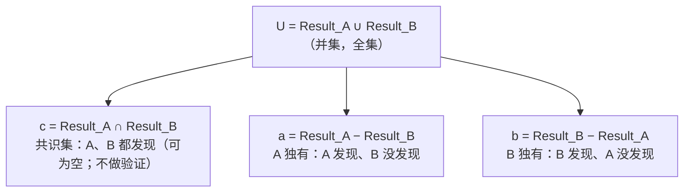

### 3.2 a 二分（已订正）

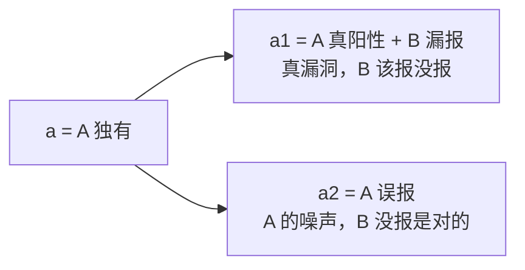

> **订正**：原文「a2 表示 A 线路漏报」应为「**a2 表示 A 线路误报**」。
> 理由：(1) a2 必须落在 `a = A 独有` 里，而「A 漏报」指 A 没发现、不属于 a；
> (2) 阶段 1 把 a1+a2 写进 `prompt'` 教 B，只有「a1 = 该抓没抓」和「a2 = 别跟着瞎报」才讲得通。

### 3.3 b 三分

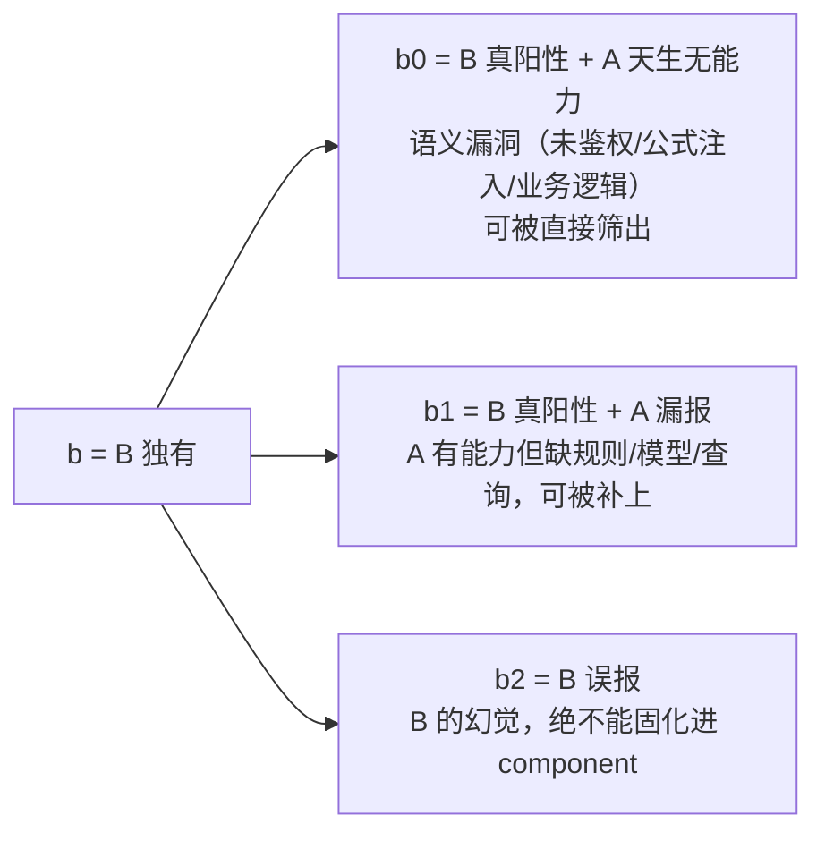

### 3.4 为什么 a 是二分、b 是三分（不对称性的来源）

- **A（标准线路）** 是确定性、能力有明确边界的。它的漏报（= b1）可以通过**扩充 component** 修复；
  但 A 不会「凭空产生一个它完全不懂的类别」——所以 a 里没有「A 天生多发现一类」的分支，a 只有「真/误」二分。
- **B（agent/LLM）** 是开放世界的，能发现 A 结构性做不到的语义问题（= b0），也会幻觉（= b2）。
  所以 b 必须三分：`b0`（A 做不到）、`b1`（A 漏了可补）、`b2`（B 胡说）。

---

## 四、「Component」抽象（CodeQL 主力 + taint 三类模型）

### 4.1 各线路的能力决定性部件

> **主力标记**：⭐ = standard 线主力工具，进化重心。

| 线路 | 工具 | 能力决定性部件（Component） | 在 v3.0 代码中的位置 |
|---|---|---|---|
| A | **codeql ⭐** | **QueryPack**（`.ql` 查询 + 标准套件引用）+ **MaD 模型包**（sinkModel 扩展） | `codeql/queries.rs`、`codeql/models.rs` |
| A | taint | **TaintModelCatalog**（sink + source + sanitizer 三类模型）+ **PackageRule** | `models/sinks/*.toml`、`models/package_inference.toml` |
| A | rule | **RuleBook**（capabilities → indicators → patterns） | `rules/languages/keywords.toml`、`rules.rs` |
| B | agent | **Prompt**（指令模板 = agent 的「知识」） | `agent/prompt.rs` |

### 4.2 关键发现：ModelCatalog 是「枢纽部件」，CodeQL 是最大受益者

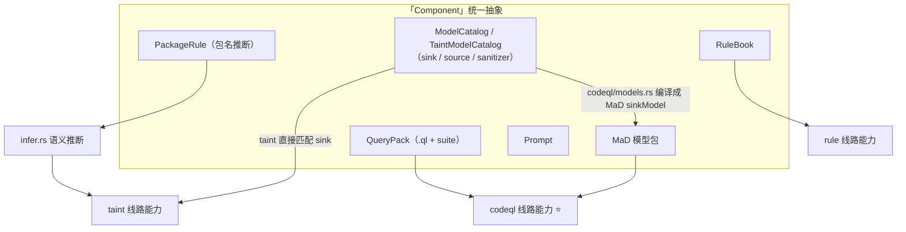

> **含义**：进化一次 `ModelCatalog`，同时提升 taint 和 **CodeQL** 两条子线路的能力（MaD 正是由它编译出来的）。
> 因为 **CodeQL 精度最高、是 standard 线主力**，v4.0 把「一次进化、CodeQL 优先受益」作为核心设计原则。

### 4.3 Component 抽象的形式化（trait 形态）

```rust
/// 一个工具的能力决定性部件，支持「可回滚的进化」。
trait Component {
    /// 该部件决定哪条线路/工具的能力。
    fn tool(&self) -> ToolKind;                 // Codeql | Taint | Rule | Agent

    /// 能力指纹（内容哈希）：用于跨阶段对比与回滚判定。
    fn fingerprint(&self) -> String;

    /// 试探性进化：返回进化后的 Component（旧快照保留，写 staging 不回写 learned）。
    fn evolve(&self, delta: &ComponentDelta) -> Component;

    /// 固化（真进化）：把验证通过的 delta 持久化为 learned_component。
    fn promote(&self, delta: &ComponentDelta) -> learned_component;

    /// 回滚：恢复到 evolve 之前的快照（丢弃 staging）。
    fn rollback(&self, snapshot: &ComponentSnapshot) -> Component;
}
```

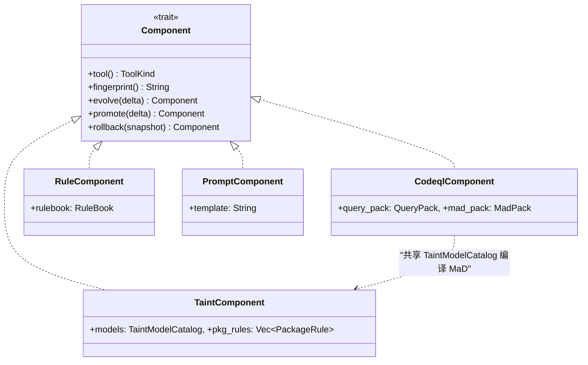

### 4.4 taint 线的 Component 详细设计（sink / source / sanitizer）

taint 分析的完整形态是「**source（外部输入）→ 传播 → sink（危险操作）**」，中间「净化函数（sanitizer）」会**截断**传播。
因此 taint 的 component 至少要包含三类模型，而不能只有 sink。

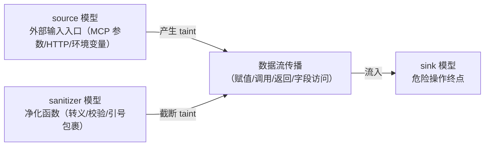

#### 4.4.1 三类模型与现状对照

| 模型 | 作用 | v3.0 现状 | v4.0 目标 |
|---|---|---|---|
| **SinkModel** | 危险操作终点（数据流到这就出漏洞） | ✅ 已有（`SinkModel`：language/category/patterns） | 保持，且编译成 MaD 喂给 CodeQL |
| **SourceModel** | 外部输入入口（不可信数据的来源） | ⚠️ 仅**结构化识别**（MCP tool 参数、entrypoint），无独立模型 | 独立建模，可进化（补漏掉的 source） |
| **SanitizerModel** | 净化函数（数据经过它就不再危险） | ❌ **完全没有** | 新增；它是消解 a2（A 误报）的关键 |

#### 4.4.2 三类模型的 schema（建议）

```rust
struct SourceModel {
    language: String,          // python / javascript / rust
    category: String,          // 输入类别：mcp_param / http_request / env_var ...
    patterns: Vec<String>,     // 匹配表达式，如 "request.get"、"os.environ"
    source: Option<String>,    // manual / learned
    learned_from: Option<String>,
}

struct SinkModel {             // 现有，保持不变
    language: String,
    category: String,          // command_execution / file_read / ...
    severity: Severity,
    confidence: Confidence,
    patterns: Vec<String>,     // 如 "subprocess.run"、"openpyxl.load_workbook"
    source: Option<String>,
    learned_from: Option<String>,
}

struct SanitizerModel {
    language: String,
    patterns: Vec<String>,     // 如 "html.escape"、"shlex.quote"、"re.escape"
    neutralizes: Vec<String>,  // 净化哪类危险：["xss"] / ["command_execution"] ...
    source: Option<String>,
    learned_from: Option<String>,
}
```

#### 4.4.3 三类模型与进化信号的对位

| 进化信号 | 补的模型 | 效果 |
|---|---|---|
| **b1**（A 漏报的 sink / source） | 加 SinkModel / SourceModel | **召回↑** |
| **a2**（A 误报） | 加 SanitizerModel | **精度↑**（很多 A 误报源于「不知道某个函数是净化函数，导致 taint 没被截断」） |

> **关键洞察**：a2 往往不是「匹配错了」，而是「taint 该截断没截断」。
> 把「B 认为是误报的 A 独有项」反推出一个 `SanitizerModel`，是最干净的降噪方式——**补 sanitizer 就是补精度**。

---

## 五、两阶段路程（完整版）

### 5.1 总览

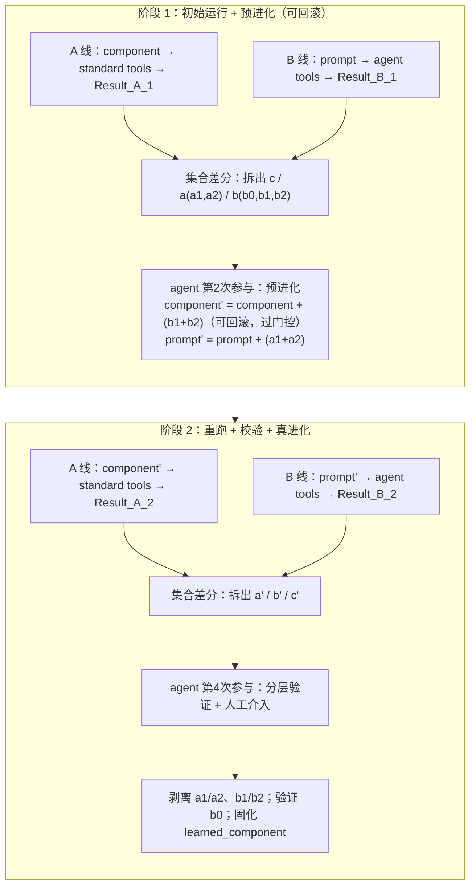

> **阶段 2 的目的（最终）**：① 剥离 a1/a2；② 剥离 b1/b2；③ 验证 b0；④ 完成真进化得到 `learned_component`。
> 注意：**c（共识集）不做验证**（双方都报，真阳性概率高，且不参与进化）。

### 5.2 阶段 1 详细时序

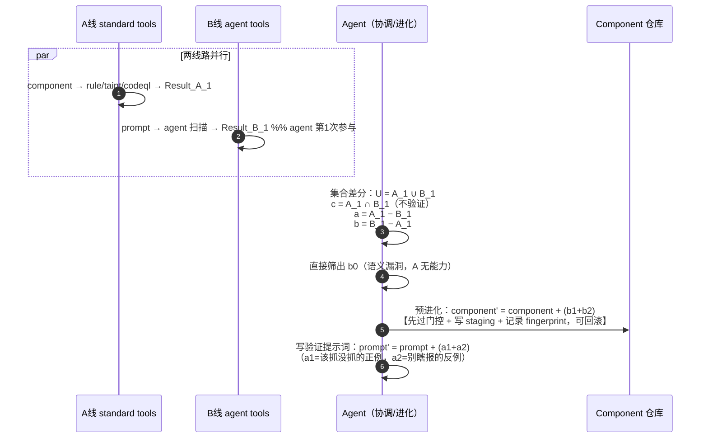

### 5.3 阶段 2 详细时序

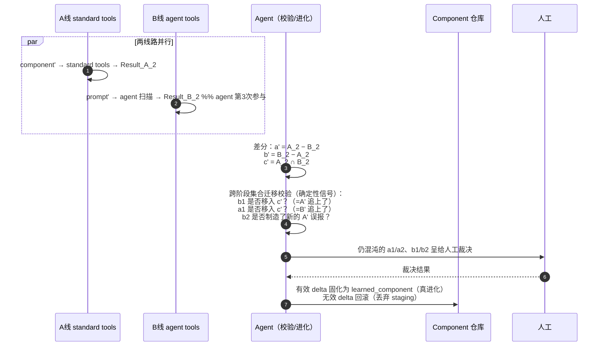

### 5.4 跨阶段「集合迁移」是破混沌的自动信号

一个 finding 在阶段 2 的「集合归属变化」本身就是验证信号：

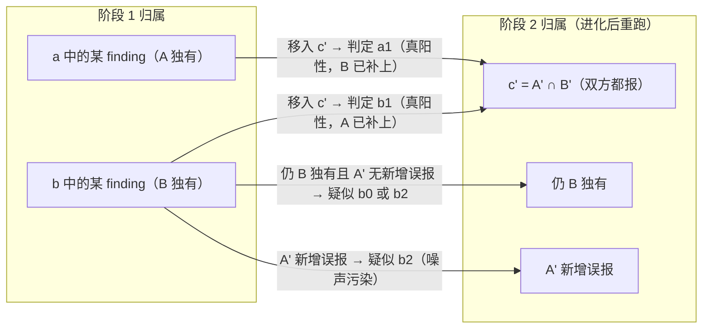

> **决策规则**（可自动化，人工只兜底）：
> - `b 独有 → c'`：b1 确认，component 该条 delta **固化**；
> - `a 独有 → c'`：a1 确认，prompt 该条 delta **固化**；
> - `b 独有 → A' 新增误报`：b2 确认，component 该条 delta **回滚**；
> - 仍混沌的条目：交给人工。

### 5.5 Component 生命周期状态机

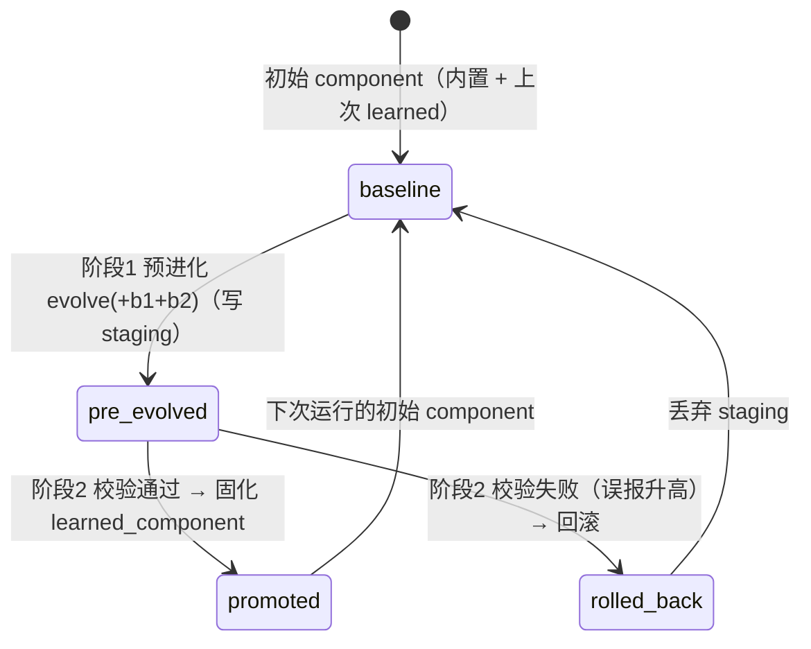

---

## 六、可行性分析

### 6.1 结论：分三档落地（CodeQL 优先）

| 档 | 内容 | 难度 | 阻塞 |
|---|---|---|---|
| **L1（必做，低风险）** | Component 抽象 + 集合差分 + b0 筛选 + 阶段 2 跨阶段迁移校验 | 低 | 无 |
| **L2（核心，中风险）** | 可回滚预进化（snapshot + rollback）+ 验证提示词 prompt' | 中 | 无硬阻塞，需定义回滚度量 |
| **L3（真进化，高风险）** | 把验证通过的 delta 固化进 learned_component，**优先喂回 CodeQL（MaD）**，其次 taint | 高 | **MaD 必须打开（见 6.3）** |

### 6.2 直接受益：v4.0 恰好补上 v3.0 的三个已知缺陷

`../v3.0/ARCHITECTURE.md` 第六节诚实标注了 3 个「理想 vs 现实」的差距，v4.0 一一对应：

| v3.0 已知缺陷 | v4.0 如何解决 |
|---|---|
| **Step 16 推断太粗糙**（`get_*` 被误判成网络请求） | 差分反馈把「A 误报（a2）」显式分离，反推出 SanitizerModel 或约束推断规则，而不是无脑 `get→网络`。 |
| **Step 28 温回灌只重跑 taint，不重跑 CodeQL** | Component 抽象 + MaD 打通后，进化一次 ModelCatalog **同时作用于 taint 和 CodeQL**，且 CodeQL 优先。 |
| **Step 32 溯源是假的**（`learned_from` 写死） | learned_component 的 `learned_from` 指向「阶段 2 校验通过的 delta + 人工裁决记录」，溯源真实。 |

### 6.3 CodeQL MaD 必须打开

- 现状：`codeql/mod.rs` 里 `MAD_INJECT_ENABLED = false`（const），因为 CLI 2.26.2 的 `--model-packs` 在 overlay-eval 模式下拒绝 3 列 `sinkModel` 扩展（"Expected 4, but was 3"）。
- **v4.0 决策：MaD 不关闭、必须打开**（这是 CodeQL 进化的前提，而 CodeQL 是主力）。
- 落地动作：
  1. **升级 CodeQL CLI 到 2.26.3+**（2.26.2 的 manifest bug 在 2.26.3 修复）；
  2. 把 `MAD_INJECT_ENABLED` 翻成 `true`；
  3. **回退版本 pin**：`queries.rs` 里为规避 2.26.2 而 pin 的 suite 版本（`codeql/python-queries@1.8.7` 等）在 2.26.3+ 应改回非版本化引用（源码注释已注明 "Revert to unversioned refs after a CLI upgrade to 2.26.3+"）；
  4. 同步验证 MaD 3 列 `sinkModel` 扩展在 2.26.3 的 overlay-eval 下通过。

> 依赖记忆：`codeql-cli-pack-pinning`（2.26.2 vs 2.26.3 manifest bug、已 pin 的可用 pack 版本、Rust extractor 宏注意事项）。

---

## 七、关键机制：混沌态剥离 / 门控试探 / 回滚 / 验证提示词

### 7.1 混沌态剥离（分层验证）

**疑问**：能不能靠 agent 对比分析两阶段结果，**完全**剥离 a1/a2、b1/b2 两个混沌态？

**答案：不能保证完全剥离。** 三个原因：

1. **循环性**：b2 是 B（agent）**自己的幻觉**。让同一个 agent 去判断「我上一轮是不是幻觉了」，本质是让 LLM 给自己的错误背书——而 LLM 恰恰**不知道自己何时幻觉**，它通常对每个回答都高置信。
2. **无真值锚点**：「这是不是真漏洞」需要语义真值。agent 只有语义理解，没有「可复现的真值」——它无法区分「我很有把握」和「真的是对的」。
3. **迁移判断本身有误差**：让 agent 判断「这条 b 是否移入了 c'」，等同于再让 agent 做一次「A 和 B 是否一致」的裁决，误差会累积。

**可行方案：分层验证——agent 只做「提案者 + 解释者」，裁决权交给确定性引擎和人类。**

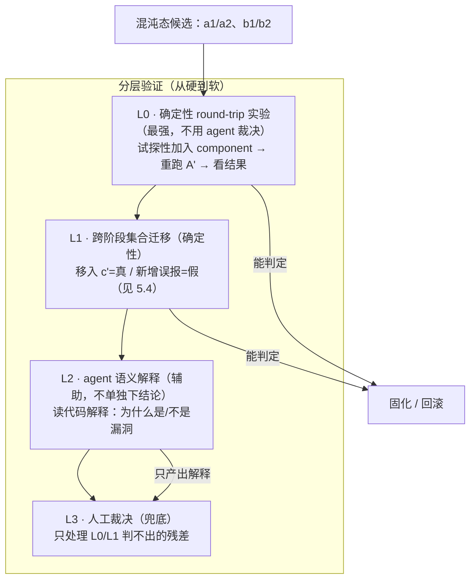

> **核心原则**：**验证权在确定性引擎（round-trip 结果）和人类手里；agent 只负责「提出候选」和「解释理由」，不负责「下最终结论」。**
> 换句话说：破混沌靠的是「把候选真的加进去、再让确定性引擎跑一遍看对不对」，而不是「让 agent 再想一遍」。

### 7.2 门控 + 试探性加入的具体细节

`component' = component + b1 + b2` 不能盲加。正确顺序是「三道门控 → 试探性加入 → round-trip 决定去留」。

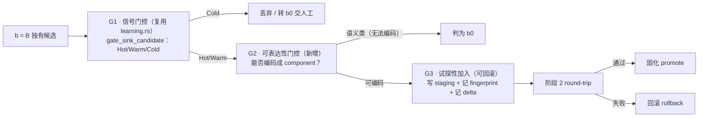

#### G1 · 信号门控（复用现有 `gate_sink_candidate`）

对每条 B 独有候选，交叉核对廉价推断启发式：

- **Hot**：候选的 `module.function` 与 `PackageRule`（包名分类）在**同一类别**上一致 → 可信，放行；
- **Warm**：只有命名前缀（`load→file_read` 等）相符 → 半信，放行但标记低置信；
- **Cold**：无任何推断信号 → 丢弃，或作为 b0 候选交人工。

> 目的：挡住 b2 里最明显的噪声，减少「盲加」的污染面。gate 是**第一道过滤**，rollback 是**第二道安全网**。

#### G2 · 可表达性门控（针对 CodeQL 主力）

候选过了 G1 后，还要判断「它到底能不能被编码成 CodeQL 的 component」，这决定走哪条进化路径：

| 候选形态 | 编码路径 | 例子 |
|---|---|---|
| `module.function` 且 category 能映射到 `mad_sink_kind` | **MaD sinkModel 扩展**（数据驱动，最省事） | `openpyxl.load_workbook` → `path-injection` |
| 有明确 module.function 但无标准 sink kind，需自定义数据流 | **新增/改写 `.ql` 查询**（代码驱动） | 自定义跨函数追踪 |
| 语义类（无数据流、无 pattern 可表达） | **判为 b0**，不进化 component，交人工/agent 语义层 | 「未做鉴权」「公式注入」 |

> 这条门控对应「4.1 里 codeql 的 component = QueryPack + MaD」：能挂到 MaD 的走 MaD，需要新查询的走 QueryPack，都挂不上的就是 b0。

#### G3 · 试探性加入（staging + 快照）

- **写 staging**：把候选编码成的 delta（MaD 模型 / `.ql` / 三类模型）写到**临时 staging 目录**，**不**写进 `learned/`（learned 只放验证通过的）。
- **记快照**：对当前 component 取 `fingerprint()`（内容哈希），连同 delta 一起记录，供阶段 2 判定「该 promote 还是 rollback」。
- **应用**：用 staging 里的 delta 构造 `component'`，喂给阶段 2 的 A 线重跑。

### 7.3 回滚机制：快照 + 决策度量

- **快照**：`evolve` 前对 component 取内容哈希（`fingerprint()`），delta 单独记录，回滚即「丢弃 staging、恢复旧指纹」。
- **决策度量**（何时判定「进化失败」→ 回滚）：一个可观测代理指标，例如
  > 若阶段 2 中 A' 的**误报率显著上升**（新增误报数 > 阈值）且**真阳性无同量级增长**，则判定该 delta 有害，回滚。
- 因为 A（标准线路）是确定性的，同一份 component 在阶段 1/2 的误报率可精确对比（不像 B 有随机性）。

### 7.4 验证提示词 prompt' 的构造

`prompt' = prompt + a1 + a2` 要写成「带标签的反例/正例」，而不是把 A 的结果原样贴进去：

```text
[原始 prompt：审查这个 MCP 项目的安全问题……]

## 上一轮标准工具（rule/taint/codeql）发现、但你可能遗漏的（请重点复核是否真实）
- {a1 候选：文件:行号，类别，证据}

## 上一轮标准工具报告、但疑似误报的（请勿重复报告）
- {a2 候选：文件:行号，类别，为什么可能是误报}
```

> 这样 a1 当**正例**（教 B 补漏），a2 当**负例**（教 B 去噪），正是「验证提示词」的含义。

---

## 八、日志系统优化（广泛插桩）

### 8.1 目标

终端打印的日志应显示**大部分中间结果和过程标识**，让使用者在运行过程中能看到：
**中间运算结果、关键数据流转、关键步骤、各阶段的输入输出数量**——越详细越好。

### 8.2 现状

v3.0 已有 `tracing` + 按 target 分级过滤（`cli/src/logging.rs`），`pipeline.rs` 里有 `info_span!` 和少量 `progress()`。
但终端 `progress()` 太稀疏，只打印「Running rule analysis… / done: N findings」这类概要，
**中间的 fact 抽取细节、taint 路径、gate 判定、fusion 分组、CodeQL 建库/查询解析都不打印**——黑盒跑完。

### 8.3 插桩原则

- **终端（INFO/DEBUG）**：打印人类关心的中间结果——每步的输入/输出数量、关键数据流转、gate 决策、进化决策。
- **文件（TRACE）**：全量插桩（每条 fact、每条路径的节点序列、每个打分），供事后审计与复现。
- **统一风格**：关键数据流转用一行式 `source → f1 → f2 → sink(category)` 打印，便于扫读。
- 复用 `tracing` 的 target（`mcp_sec_audit::rule` / `::taint` / `::agent` / `::codeql` / `::learning` / `::fusion`），新增 `::component`、`::validate`。

### 8.4 广泛插桩清单（映射到真实代码）

| 模块 | 文件:函数 | 插桩内容（中间结果 / 数据流转） |
|---|---|---|
| 发现 | `discovery.rs` | 发现 N 文件；按语言分组 counts；排除的干扰目录 |
| rule | `rule/mod.rs:600` | 每能力的命中数、evidence 行号列表 |
| facts | `facts/pipeline.rs:32` | 每文件抽取的 fact 计数（import/call/sink/function/entrypoint 各多少） |
| 推断 | `infer.rs:14` / `infer.rs:150` | 每层推断命中的 sink 名 + 类别 + 置信度 |
| taint | `taint/propagation.rs:41,50` | **每条 source→…→sink 路径**（节点序列 + 类别） |
| agent | `agent/prompt.rs` / `agent/parser.rs` | prompt 的文件数/长度；解析出 N findings + M candidates |
| codeql | `codeql/mod.rs:143` | 建库语言；query pack 解析结果（.ql 数 + suite refs）；SARIF 结果数 |
| learning | `learning.rs:23` | **每条 candidate 的 gate 判定**（Hot/Warm/Cold + 命中哪条 PackageRule） |
| fusion | `fusion/matcher.rs` / `fusion/scorer.rs` | 分组数；每组的支持源（rule/taint/agent/codeql）+ 打分 |
| 进化(新) | `component/evolve` | delta 内容、fingerprint、promote/rollback 决策 |
| 校验(新) | `validate.rs` | 跨阶段迁移结果：哪条 b→c'、哪条 b→新增误报 |

### 8.5 关键数据流转的可视化示例

```
[taint] source:run_command.param(command) → command.strip() → sp.run(command) → sink(command_execution)
[gate]   candidate 'openpyxl.load_workbook' → Hot（PackageRule openpyxl → file_read）
[codeql] python DB built; query pack: 3 .ql + codeql/python-queries@1.8.7; SARIF: 12 results
[fusion] 48 groups; group#7 {rule+taint+codeql} severity=high conf=0.92
[evolve] delta +3 sink models → staging; fingerprint a1b2c3d4
[validate] b1 'openpyxl.load_workbook' → c' (A' caught it) → PROMOTE
```

---

## 九、映射到 v3.0 代码

| v4.0 概念 | 落地位置（现有 / 新增） | 动作 |
|---|---|---|
| Component trait | 新增 `src/static_analysis/component.rs` | 新建 trait + 四个实现（Codeql 优先） |
| TaintModelCatalog（三类） | `models/mod.rs`（扩展） | 从「只 sink」扩成 sink + source + sanitizer |
| QueryPack / MadPack | `codeql/queries.rs`、`codeql/models.rs` | 包一层 `CodeqlComponent`；**打开 MaD** |
| RuleBook | `rules.rs` | 包一层 `RuleComponent` |
| Prompt | `agent/prompt.rs` | 包一层 `PromptComponent` |
| 集合差分 | 新增 `src/static_analysis/diff.rs` | `diff(a,b) -> {c, a_only, b_only}` |
| b0 筛选 | 新增 `diff.rs` 或复用 `category.rs` | 按「A 无对应 component 类别 / 可表达性门控失败」判 b0 |
| 可回滚预进化 | `learning.rs`（扩展） | `evolve` + staging + snapshot + `rollback` |
| 验证提示词 | `agent/prompt.rs`（扩展） | 注入 a1/a2 标签段 |
| 跨阶段迁移校验 | 新增 `src/static_analysis/validate.rs` | 对比阶段 1/2 集合归属 |
| 固化 learned_component | `learning.rs`（扩展 `write_learned_sinks`） | 只固化校验通过的 delta，溯源真实 |
| 阶段编排 | `pipeline.rs` | 从「单轮」改成「两阶段循环」 |
| 日志插桩 | 全模块 `tracing` | 按 8.4 清单广泛插桩，新增 target |

---

## 十、风险与待决问题

| # | 风险 / 待决 | 建议 |
|---|---|---|
| R1 | **回滚度量没有 ground truth**：误报率上升 ≠ 一定有害（可能恰好暴露了新真阳性）。 | 用「真阳性/误报 同量级对比」而非绝对阈值；无法裁决时交人工。 |
| R2 | **B 有随机性**：阶段 1/2 两次 agent 扫描结果可能因采样温度不同而漂移，导致集合迁移信号被噪声淹没。 | agent 扫描用低温/固定 seed；或对 B 结果做多次采样取交集。 |
| R3 | **b0 直接筛选依赖「A 无对应类别」判定**：边界 case（如 prompt injection 其实 codeql 有 query）会误判。 | b0 筛选做成「可配置的能力清单」，人工可覆盖。 |
| R4 | **进化失控 / 组件爆炸**：多次运行后 learned_component 无限膨胀。 | 对 learned_component 设上限 + 定期 prune（低置信、长期无命中者淘汰）。 |
| R5 | **sanitizer 模型语义**：净化函数「净化哪类危险」的 `neutralizes` 分类可能与 sink 类别不对齐。 | 复用同一套 category 枚举，做映射校验。 |

---

## 十一、落地路线图（CodeQL 优先）

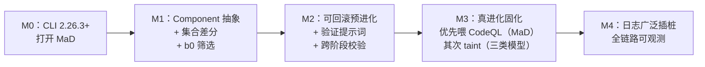

| 里程碑 | 内容 | 验收标准 | 依赖 |
|---|---|---|---|
| M0 | 升级 CodeQL CLI ≥ 2.26.3，`MAD_INJECT_ENABLED=true`，回退 suite 版本 pin | MaD sinkModel 扩展在 overlay-eval 下通过 | 无 |
| M1 | Component trait + 四实现 + `diff.rs`（c/a/b + b0）+ 可表达性门控 | 单测：给定两组结果，正确产出 c/a/b 与 b0 | M0 |
| M2 | `evolve`/`rollback` + prompt' 注入 + `validate.rs` 跨阶段迁移 | 集成测试：模拟 a1/b1/b2，正确固化/回滚 | M1 |
| M3 | 校验通过的 delta 固化，**优先喂回 CodeQL（MaD）**，其次 taint | 端到端：二次扫描 CodeQL 新增第三方 wrapper 的 sink 命中 | M2 |
| M4 | 全模块日志插桩（按 8.4 清单） | 运行时终端能看到中间结果、数据流转、gate/进化决策 | M3 |

---

## 附：术语速查

| 术语 | 含义 |
|---|---|
| Component | 决定某工具「能力」的部件（QueryPack+MaD / TaintModelCatalog / RuleBook / Prompt） |
| Result_A / Result_B | 标准线路 / agent 线路各自产出的 finding 集合 |
| c / a / b | 共识集 / A 独有 / B 独有 |
| a1 / a2 | A 真阳性+B漏报 / A 误报 |
| b0 / b1 / b2 | 语义漏洞（A 无能力）/ B真阳性+A漏报 / B 误报 |
| 预进化 / 真进化 | 可回滚的试探性进化 / 校验通过后的固化 |
| learned_component | 校验通过、持久化的 Component |
| staging / promote / rollback | 试探性进化写入的临时区 / 校验通过固化 / 校验失败回滚 |
| MaD | Models as Data：CodeQL 的数据模型扩展（sinkModel） |
| sanitizer | 净化函数：截断 taint 传播，消解误报 |
| 跨阶段迁移 | finding 在阶段 1→2 的集合归属变化（破混沌的确定性信号） |
| 分层验证 | L0 round-trip 实验 → L1 集合迁移 → L2 agent 解释 → L3 人工 的四层验证 |
